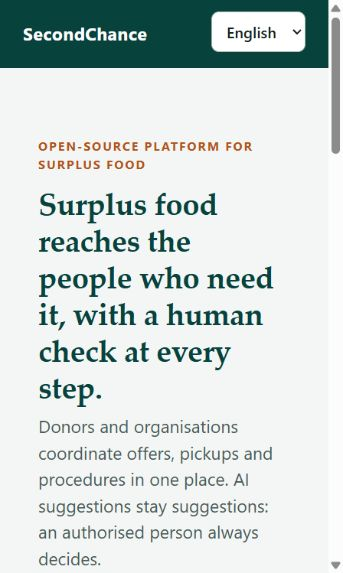
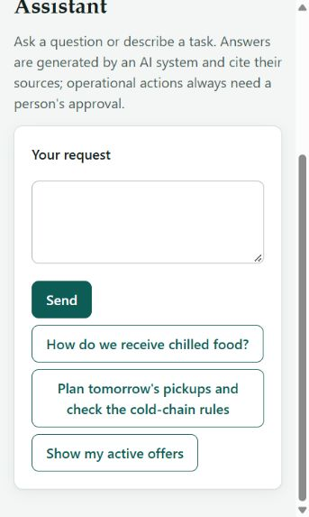
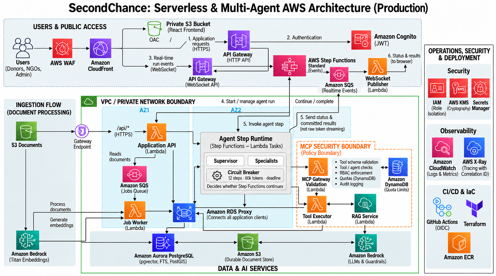

# SecondChance

SecondChance is a source-available coordination platform, free for non-profit and charitable organisations, that helps surplus food reach people instead of becoming waste. Donors publish available food, NGO networks organise the work, coordinators reserve offers, and authorised people remain in control of every operational decision.

The platform combines a multilingual web application, strict tenant isolation, asynchronous workers, grounded knowledge search and governed AI agents. AI can retrieve procedures, explain evidence and prepare a plan; it cannot silently allocate food or bypass a human approval.

## See it in action

| Public landing and local demo access | Coordinator assistant |
|---|---|
|  |  |

The interface is responsive and available in English, Danish, Polish and Italian. Navigation is adapted to the active membership, while the API independently enforces every permission.

## What the product offers

- **Donor and NGO onboarding.** People register as a donor or an organisation. Network and platform administrators review requests before access becomes active.
- **Surplus offer management.** Donors publish quantities, categories, storage conditions and collection windows. Coordinators see only offers available to their network and can reserve them safely under concurrency.
- **Human-controlled allocation.** The platform can rank or suggest an allocation, but a mission is created only after an authorised person approves it.
- **Shared operational knowledge.** Administrators upload PDFs into role-aware knowledge spaces. Documents are parsed and indexed in the background, then searched with PostgreSQL full-text search and `pgvector`.
- **Grounded answers.** Answers cite the retrieved document sections. If the evidence is weak or a Bedrock guardrail rejects the answer, the system abstains instead of guessing.
- **Hybrid intent routing.** `/assist` chooses the least expensive safe path: direct operation, search, one specialist, a multi-agent plan or a clarification request.
- **Governed specialist agents.** A supervisor may compose a plan only from the versioned specialist catalog. Agent output cannot invent permissions or grant itself tools.
- **MCP tool governance.** Every agent tool call crosses a dedicated MCP Gateway that validates schemas, checks the agent and role allow-lists, applies distributed quotas, writes an audit event and invokes only the private tool executor.
- **Privacy and operations by design.** The project includes tenant Row-Level Security, append-only audit records, data minimisation, retention jobs, OpenTelemetry, CloudWatch alarms and an account-wide AWS budget.

## AWS architecture



[Open the full-resolution architecture image](docs/images/aws-architecture-production.png)

The order is intentional:

1. **AWS WAF and CloudFront are the web front door.** WAF filters edge traffic; CloudFront serves the React application from a private S3 bucket through Origin Access Control.
2. **Cognito establishes identity; API Gateway protects the backend.** The browser signs in with Cognito Hosted UI and PKCE, then sends the JWT to API Gateway. The gateway validates the token and applies throttling before the request can reach FastAPI.
3. **The API Lambda performs application authorisation.** Memberships and capabilities come from PostgreSQL, not from user-controlled claims. Requests are rejected before expensive work when they are malformed, oversized, unsupported or over quota.
4. **Durable orchestration separates the request from the AI run.** The API starts one AWS Step Functions Standard Workflow per agent run. The workflow can outlive any individual compute invocation and calls a short, idempotent agent step at a time. SQS remains the durable buffer for document ingestion and real-time delivery events.
5. **Private compute performs bounded work.** The jobs worker parses and indexes documents. The agent-step runtime executes one supervisor or specialist turn, commits its state and shared memory, then returns control to Step Functions. No long-running supervisor process has to remain reachable.
6. **The MCP Gateway stands in front of every agent tool.** Agents cannot invoke the domain executor directly. The gateway is a separate Lambda, image, IAM role, log group and concurrency bulkhead.
7. **The tool executor stays private.** Only the MCP Gateway role can invoke it. It runs approved read-only knowledge tools against tenant-scoped data.
8. **Data and model access remains private.** Application compute runs in private subnets across two Availability Zones. Aurora is reached through RDS Proxy, while S3, SQS, DynamoDB, Secrets Manager, Lambda, Step Functions and Bedrock use VPC endpoints; the VPC has no NAT gateway.
9. **The browser receives real-time progress safely.** Agent steps publish small status events to SQS. A public relay with no database permission delivers them through API Gateway WebSockets. The UI keeps polling as a recovery path. Only committed, policy-checked results are exposed; raw model tokens are not streamed before guardrails.

### Production controls highlighted in the diagram

The diagram highlights four explicit production controls implemented by the stack:

| Control | Placement | Why it exists |
|---|---|---|
| **Step Functions Standard Workflow** | between the application API and the agent-step runtime | owns the durable supervisor loop, retries transient compute failures and removes the 15-minute Lambda limit from the overall run |
| **RDS Proxy** | between all application database clients and Aurora | pools connections, absorbs Lambda concurrency spikes and preserves IAM database authentication |
| **API Gateway WebSocket API** | parallel to the HTTP API, in front of the browser event channel | sends progress and final-state events without holding a 29-second HTTP request open |
| **Run circuit breaker** | enforced transactionally in Aurora after every step | stops immediately when the run reaches 12 steps, 60,000 tokens or its deadline; the UI exposes the consumed and maximum budgets |

### Why there are two gateways

| Boundary | What it protects | What it allows through |
|---|---|---|
| **API Gateway** | the public application backend | authenticated, throttled HTTP requests from the web app |
| **MCP Gateway** | private tools, data and model-backed operations | schema-valid calls from approved agents and roles, within quota |

The API Gateway is the public ingress. The MCP Gateway is an internal policy enforcement point. Putting the MCP Gateway after the agent-step runtime and before the tool executor prevents model output from becoming direct infrastructure access.

## Runtime flows

### A normal application request

```text
Browser
  → WAF / CloudFront → private S3 web application
  → Cognito Hosted UI → JWT
  → API Gateway JWT authorizer + throttling
  → FastAPI Lambda → tenant transaction → Aurora / S3 / SQS / Bedrock
```

### A governed agent tool call

```text
Browser → API Gateway HTTP API → API Lambda → Step Functions Standard Workflow
  → Agent Step Runtime [one bounded supervisor or specialist turn]
  → MCP Gateway [schema + allow-list + role + quota + audit]
  → private Tool Executor Lambda
  → RDS Proxy → tenant-scoped Aurora / S3 / Bedrock operation
  → SQS real-time events → WebSocket relay → API Gateway WebSocket → Browser
```

### A grounded knowledge answer

```text
Question → tenant and role context → hybrid retrieval (FTS + pgvector)
  → evidence threshold → Bedrock Converse + Guardrail
  → cited answer, or an explicit abstention
```

The detailed visual flows are available as standalone documents:

- [AWS architecture](docs/diagrams/01-aws-architecture.html)
- [Human approval sequence](docs/diagrams/02-fl01-approval-sequence.html)
- [Grounded RAG flow](docs/diagrams/03-fl02-rag-flow.html)

## Stack at a glance

| Layer | Technology | Responsibility |
|---|---|---|
| Web | React, TypeScript, Vite, nginx | multilingual, capability-aware user experience |
| Identity | Amazon Cognito, Hosted UI, OAuth 2.0 PKCE | sign-in and short-lived JWTs |
| Public API | API Gateway HTTP API, JWT authorizer | public ingress, token validation and throttling |
| Application | FastAPI on AWS Lambda | domain API, admission control, permissions and orchestration |
| Orchestration | Step Functions Standard, bounded Lambda steps | durable multi-agent loop, retries and state transitions without a 15-minute workflow ceiling |
| Workers | Lambda, SQS, dead-letter queues | document ingestion and asynchronous event delivery |
| Tool boundary | MCP Gateway Lambda, DynamoDB quotas | tool policy, validation, audit and rate limiting |
| Private tools | Tool Executor Lambda | approved domain operations with no public route |
| Relational and vector data | RDS Proxy, Aurora PostgreSQL Serverless v2, PostGIS, pgvector | pooled IAM-authenticated connections, tenant data, workflow state, full-text and vector search |
| Object data | Amazon S3, KMS | tenant-prefixed source documents and objects |
| Generative AI | Amazon Bedrock Converse, Titan Text Embeddings, Bedrock Guardrails | routing, generation, embeddings and safety checks |
| Real-time channel | API Gateway WebSocket, DynamoDB connection registry, SQS relay | authenticated run subscriptions and immediate committed-state updates |
| Network | private VPC, two Availability Zones, VPC endpoints, no NAT | private service connectivity and reduced egress exposure |
| Operations | CloudWatch, X-Ray, SNS, AWS Budgets, OpenTelemetry | logs, traces, metrics, alarms and cost awareness |
| Delivery | Terraform, ECR, GitHub Actions OIDC | reproducible infrastructure and keyless deployment |

## Security model

- PostgreSQL Row-Level Security is the final tenant boundary. Every tenant transaction sets `app.tenant_id`, `app.role` and `app.subject` before the first query.
- Roles live in the `membership` table and are checked on the server. Hiding a screen in React is never treated as authorisation.
- Each compute family has a separate least-privilege IAM role. Database connections use short-lived IAM authentication tokens through RDS Proxy rather than application passwords.
- S3, Aurora, logs, DynamoDB and secrets are encrypted with KMS. S3 Block Public Access is enabled.
- Guardrails are applied around model-backed answers. Prompts are not written to normal application logs.
- GitHub Actions assumes an AWS role through OIDC. The deployment path does not create or store long-lived AWS access keys.
- The MCP Gateway validates model-proposed tool use before any domain executor is invoked.

For the full analysis, see the [threat model](docs/security/threat-model.md), [GDPR notes](docs/compliance/gdpr.md) and [architecture decisions](docs/ADR.md).

## Engineering confidence

**Confidence level: high — 94%.**

This score reflects what can be demonstrated without pretending that static analysis equals a production deployment:

| Evidence | Result |
|---|---|
| API test suite | 228 passing tests |
| MCP Gateway test suite | 6 passing tests |
| Frontend test suite | 17 passing tests |
| Frontend type-check and production build | passed |
| Python lint for API and MCP Gateway | passed |
| Terraform formatting and validation | passed for bootstrap, demo and pilot stacks |
| Terraform offline tests | 2 passing infrastructure tests |
| IaC security scan | no HIGH or CRITICAL findings |
| Shell deployment scripts | ShellCheck passed |
| AWS Lambda Runtime Interface Emulation | 9 passing end-to-end tests |

The remaining uncertainty is account-specific and can only be removed by a real AWS acceptance run: Bedrock model access and quotas, regional service availability, Aurora engine behaviour, Cognito Hosted UI behaviour, Lambda concurrency quotas and live VPC endpoint policies. The deployment workflow contains a runtime probe for exactly those boundaries.

## Run locally

You need Docker with Compose v2 and [uv](https://docs.astral.sh/uv/). Node is needed only when running the frontend outside Docker.

```bash
docker compose up -d
```

Open [http://localhost:8088](http://localhost:8088). The local environment uses simulated OIDC and synthetic users; no AWS account is required.

| Service | Local address | AWS equivalent |
|---|---|---|
| `web` | http://localhost:8088 | CloudFront + private S3 |
| `api` | http://localhost:8000 | API Gateway + API Lambda |
| `db` | 127.0.0.1:5432 | Aurora PostgreSQL |
| `queue` | 127.0.0.1:9324 | Amazon SQS |
| `storage` | 127.0.0.1:8333 | Amazon S3 |
| `mcp-gateway` | 127.0.0.1:8010 | MCP Gateway Lambda |
| `tool-executor` | private Compose network | private Tool Executor Lambda |
| `agents-worker`, `jobs-worker` | private Compose network | queue-triggered Lambdas |
| `lgtm` profile | http://localhost:3000 | CloudWatch, X-Ray and an OTLP collector |

Every published local port is bound to `127.0.0.1`.

### Demo users

| User | Role | Main capabilities |
|---|---|---|
| `demo-platform-admin` | platform administrator | review networks and manage documents |
| `demo-it-admin`, `demo-dk-admin` | network administrator | review members, manage documents and coordinate work |
| `demo-it-coordinator`, `demo-dk-coordinator` | coordinator | reserve offers and use the assistant |
| `demo-it-donor`, `demo-dk-donor` | donor | publish and review their own offers |
| `demo-it-volunteer` | volunteer | search shared knowledge |

### Useful local commands

```bash
# API tests
cd api && uv run pytest

# MCP Gateway tests
cd mcp-gateway && uv run pytest

# Frontend tests and production build
cd web && npm ci && npm test && npm run build

# Optional local observability
OTEL_EXPORTER_OTLP_ENDPOINT=http://lgtm:4318 docker compose --profile observability up -d
```

Reset the local data with `docker compose down -v`.

## Deploy to AWS

The Windows entry point performs identity login, account preflight, state bootstrap, image build, Terraform apply, database migration, demo seeding, web publication and live verification:

```powershell
.\scripts\connect-aws.ps1 -Environment demo -AlarmEmail you@example.org
```

For macOS or Linux:

```bash
export SECONDCHANCE_ALARM_EMAIL=you@example.org
scripts/connect-aws.sh demo
```

The deployment uses IAM Identity Center where available and can create a repository-scoped GitHub OIDC role. See [Deploying to AWS](docs/deployment.md) for prerequisites, account bootstrap, costs, teardown and the acceptance checks.

## Repository map

```text
api/          FastAPI, domain services, agents, workers, migrations and tests
web/          React application, role-aware screens and four language packs
db/           PostgreSQL image and local role bootstrap
mcp-gateway/  independent MCP policy enforcement service
infra/        Terraform stacks, reusable module and AWS runtime emulation
scripts/      build, connect, deploy, verify, bootstrap-admin and destroy flows
local/        local service configuration
docs/         product, architecture, decisions, compliance, operations and diagrams
```

## Documentation

| Document | Purpose |
|---|---|
| [Product requirements](docs/PRD.md) | goals, users, features, metrics and scope |
| [Architecture](docs/architecture.md) | components, data model and runtime flows |
| [Architecture decisions](docs/ADR.md) | important decisions and rejected alternatives |
| [Agent guide](docs/agents.md) | governed specialists, planning and tool rules |
| [AWS deployment](docs/deployment.md) | credentials, bootstrap, deployment and verification |
| [Operations](docs/operations/README.md) | SLOs, alerts and runbooks |
| [Threat model](docs/security/threat-model.md) | threats, controls and residual risks |
| [GDPR notes](docs/compliance/gdpr.md) | data roles, minimisation and retention |

## Join the project

This repository is the starting point of SecondChance. The architecture, the local stack, the one-command AWS deployment and the test suites are in place; what comes next is shaped by the organisations that adopt it and the people who build it with them. Contributions are welcome, from code to field knowledge:

- tailoring the platform to a real NGO: its procedures, roles, languages and specialist agents;
- the first real AWS deployment, reported against the checklist in [docs/deployment.md](docs/deployment.md);
- OCR for scanned PDFs and direct-to-S3 uploads for large documents;
- human approval flows that turn an agent's proposal into an operational action;
- accessibility reviews, translations and load tests.

Start with [CONTRIBUTING.md](CONTRIBUTING.md), which also explains the contributor terms. Security issues follow [SECURITY.md](SECURITY.md).

## Licence

SecondChance is source-available under the [PolyForm Noncommercial License 1.0.0](LICENSE). Copyright (c) 2026 Pierfrancesco Lijoi.

- **Free for noncommercial use**, including use by charitable and non-profit organisations, educational institutions, public research and health organisations and public bodies, whatever their funding.
- **Commercial use needs a written licence from the author**: selling the software, offering it as a paid service, or using it in a for-profit business. Open an issue titled "Commercial licence" or contact [@PierfrancescoLijoi](https://github.com/PierfrancescoLijoi).
- Contributions are accepted under the terms in [CONTRIBUTING.md](CONTRIBUTING.md), so the project stays free for non-profits while its author can still license it commercially.
