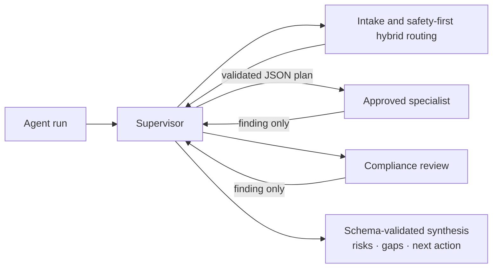

# Governed multi-agent architecture

SecondChance uses a durable supervisor-and-specialists architecture. The supervisor may decide **which approved specialists to run and in which order**, but it cannot create executable code, permissions, tools or tenant identities.

## Execution flow



Every step is stored in PostgreSQL and delivered through SQS. Leases, attempt fencing, idempotent step creation, token/step budgets, stale-step requeue and DLQs remain enforced by the runtime.

## Planning contract

The model receives the task, governed route and descriptions from the approved catalog. It returns strict JSON containing `steps`, each with an allow-listed `agent` and a bounded `objective`. The server rejects and replaces the plan with a deterministic fallback when JSON is malformed, the list is empty or too long, an agent is not registered or repeated, or an objective is invalid. After all specialists finish, a second strict schema produces a summary, risks, evidence gaps and a recommended next action; malformed or refused synthesis falls back to a deterministic operator-review result.

The model never chooses IAM roles, tenant IDs, queue names or database permissions.

## Creating a specialist

Add one object to the versioned contract `secondchance/agents/specialists.v1.json`:

```json
{
  "name": "capacity_analysis",
  "description": "Checks centre capacity against the requested movement",
  "instructions": "Analyse known capacity and timing. Never reserve resources.",
  "resources": ["run_memory", "knowledge_index", "bedrock"],
  "tools": ["knowledge_search"]
}
```

The loader validates the file schema, duplicate names, safe identifiers, allowed resources and tools, and that every tool's required resource is declared. Then include its name in a deterministic fallback route when appropriate, or let the LLM supervisor select it from the catalog. No migration is needed for a new safe snake-case name; migration `0007` constrains stored names to the same identifier format.

Every specialist created by the factory automatically reads only the run's tenant-isolated memory, receives its objective and prior findings, uses the configured model, returns a finding to the supervisor, and records token/model metadata. It cannot directly execute writes.

Each definition also declares its allow-listed shared resources. The deployed contract is visible to authorised operators at `GET /agents/catalog`; instructions and credentials are deliberately excluded.

| Resource | AWS implementation | Access contract |
|---|---|---|
| `run_memory` | Aurora PostgreSQL with tenant RLS | findings for the current tenant/run only |
| `knowledge_index` | Aurora pgvector/PostGIS plus encrypted S3 documents | retrieval through application services; no direct mutation |
| `bedrock` | Bedrock Runtime through PrivateLink and the deployed Guardrail | inference only, bounded by run token/step budgets |
| `routing_context` | deterministic intake/routing decision stored in PostgreSQL | read-only workflow context |

Step Functions is the durable AWS coordinator, while SQS carries ingestion and delivery events; neither is an agent capability. CloudWatch/X-Ray are platform telemetry. The common worker IAM role can reach only the application database identity through RDS Proxy, tenant object prefix, approved queues, models and guardrail. Logical agents never receive AWS credentials and cannot change this role.

## External MCP tool gateway

A specialist definition is not authorization. `mcp-gateway/` is an independently packaged and deployed policy-enforcement service: it does not import application modules or connect to the application database. Agents call it through an IAM-authorised synchronous Lambda invocation on AWS, or through the private Compose network locally. It validates the input contract, caller role, selected agent and per-tool quota before invoking the private domain executor.

On AWS it has a dedicated image, Lambda execution role, reserved-concurrency bulkhead, CloudWatch log group and a DynamoDB fixed-window counter with TTL. Its IAM role can invoke only `tool-executor`; the agent role can invoke only the gateway. `tool-executor` is not attached to API Gateway, and applies PostgreSQL RLS plus a database statement timeout before executing RAG. This creates two enforcement layers without exposing the database to the gateway.

| Tool | Callers | Behaviour |
|---|---|---|
| `knowledge_search` | donation, logistics, knowledge and compliance specialists; MCP clients | hybrid tenant/role-filtered retrieval; returns source chunks |
| `knowledge_answer` | MCP clients | grounded RAG answer with citations; explicitly abstains without evidence |

Both tools are read-only. Generated SQL, arbitrary HTTP, shell execution and tenant identifiers are not tool arguments. The public application no longer exposes `/tools/*`; the local gateway exposes its catalogue on `127.0.0.1:8010`, while AWS agent traffic stays private and IAM-authenticated.

For a local MCP host, start the official stdio server with a real seeded membership identity:

```powershell
.\scripts\mcp-local.ps1 -TenantId <uuid> -Subject demo-it-coordinator -Role coordinator
```

The identity environment is a local stdio development transport only. A future Internet-facing MCP transport must sit behind Cognito/OAuth or AgentCore Identity and build identity from the verified token. The current AWS transport is deliberately service-to-service only and relies on least-privilege IAM; it must not be described as a public remote MCP endpoint.

The AWS application image uses the same gateway. Terraform also supplies stable OTel service/resource attributes and accepts `otel_exporter_otlp_endpoint`; pointing it at ADOT activates the existing FastAPI, SQLAlchemy, log, metric and trace exporters without rebuilding the application. Lambda Active Tracing remains enabled independently.

Write operations remain deliberately unavailable. They must use a separate pending proposal bound to a content hash and require human approval before deterministic application code executes it.

Do not place boto3 or database mutation calls inside specialist prompts or factory handlers. The model proposes; authorised application services validate and execute.

## Built-in specialists

| Name | Responsibility |
|---|---|
| `request_analysis` | scope, assumptions and missing information |
| `donation_operations` | donation handling, timing, allergens and cold chain |
| `logistics_planning` | movement and mission feasibility without assigning people |
| `knowledge_research` | required evidence and abstention when sources are missing |
| `compliance_review` | safety, policy and human-approval review |

Local mode uses deterministic findings, so the workflow remains demonstrable without an LLM. AWS mode uses Bedrock Runtime through the existing private endpoint.

## Router policy

`SECONDCHANCE_ROUTER_MODE=hybrid` is the AWS default. Unsupported/safety-sensitive scope rules always win without a model call. Clear knowledge and direct-operation requests use the low-cost multilingual baseline. Compound or ambiguous work is classified by Bedrock with a closed route/intent enum, exact JSON schema and confidence threshold; invalid output, refusal or outage falls back safely to the baseline. `baseline` and `bedrock` remain selectable operational modes.

Rizzo Flow is supported as `rizzo_flow` primary only when `SECONDCHANCE_ROUTER_URL` is configured, but the recommended adoption path is `SECONDCHANCE_ROUTER_SHADOW_URL`: its result is recorded for evaluation and cannot affect execution. Because AWS Lambdas have no NAT, either URL must be privately reachable from the VPC. Promotion requires a representative, labelled golden set rather than a subjective model preference.
