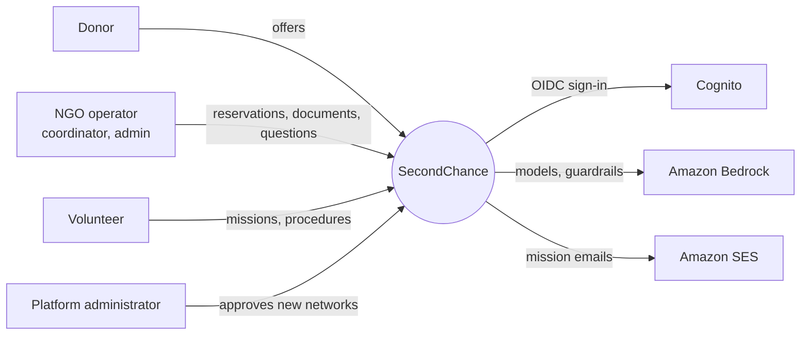
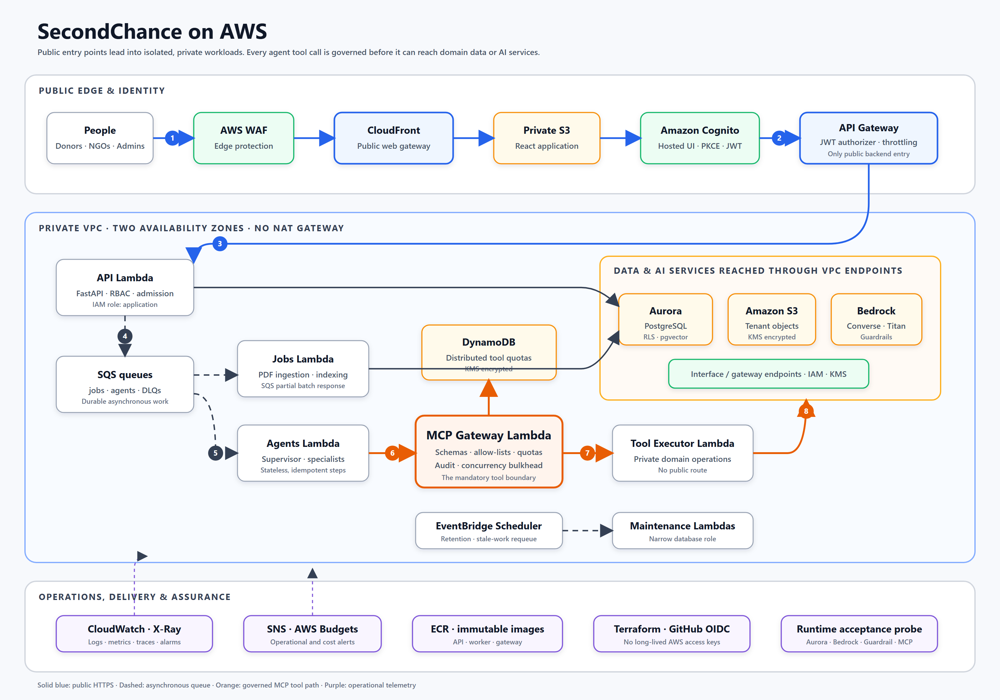
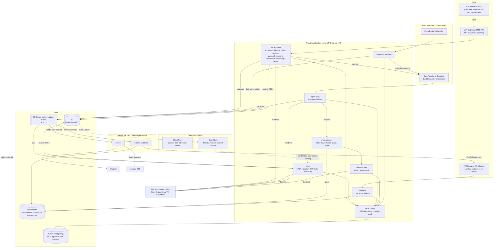
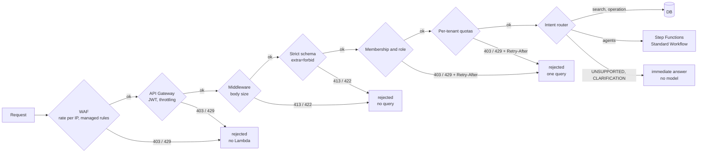
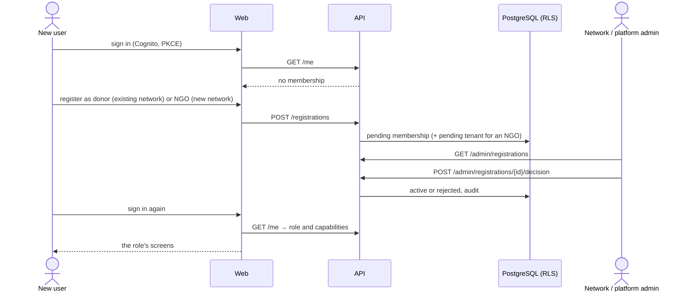
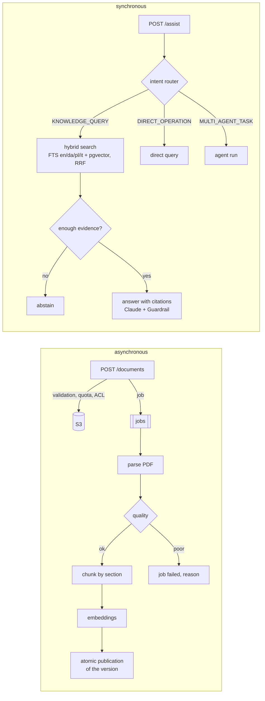
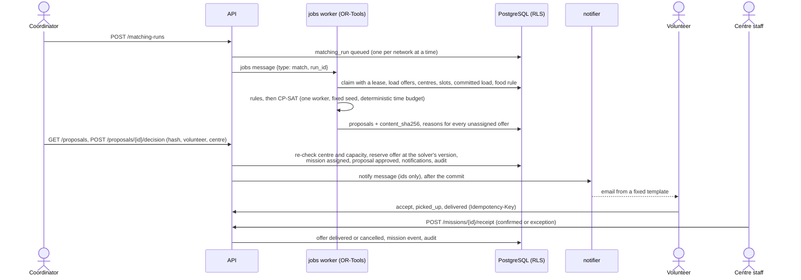
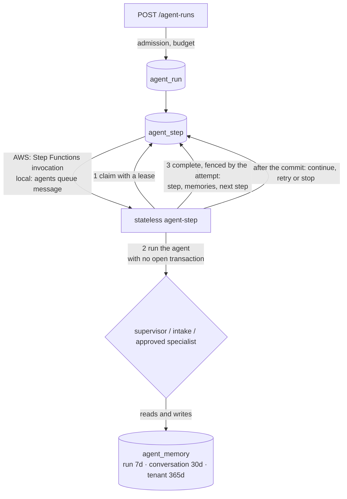

# SecondChance architecture

An overview of the system as it is in the code. Decisions and the alternatives they rejected are in the [ADRs](ADR.md); requirements in the [PRD](PRD.md); the map of AWS services, their Azure equivalents and their local equivalents in [infra/README.md](../infra/README.md). The diagrams below show the AWS deployment; the Azure one is in [deployment-azure.md](deployment-azure.md) and runs the same application.

## Constraints that drive everything

1. **One maintainer, near-zero fixed cost:** serverless with scale to zero, no clusters, no NAT (ADR-001, ADR-006).
2. **Data about vulnerable people:** tenant isolation enforced by the database, personal data classified column by column, inference in the EU (ADR-002, ADR-003, ADR-014).
3. **AI proposes, people decide:** agents work inside deterministic workflows and never confirm an allocation (ADR-010).
4. **Useless work stops at the door:** every unsuitable request is rejected at the first stage that can recognise it (ADR-016).
5. **The same code locally and on AWS:** cloud services are adapters with an equivalent in Docker Compose (NFR-013).
6. **International from day one:** English first, with Danish, Polish and Italian in the interface, the documents and the intent router (ADR-019).

## Context

## Containers

Every AWS service and every call between them, as the Terraform module defines them: [SVG](images/aws-architecture.svg), generated by [`scripts/architecture-diagram.py`](../scripts/architecture-diagram.py).

Locally: nginx instead of CloudFront, no API Gateway (the API verifies the token itself), ElasticMQ for SQS, SeaweedFS for S3, PostgreSQL in a container, deterministic embeddings or Ollama instead of Bedrock, Mailpit instead of SES.

## The path of a request: early rejection

Every stage rejects what it can recognise with the data it has, before handing over to the next, more expensive one. Details and HTTP codes in [ADR-016](ADR.md#adr-016--fail-fast-early-rejection-and-admission-control).

Checks continue after the door: PDFs are validated (signature, pages, encryption, active content) before anything is written to S3; workers drop malformed messages without retrying them; agent plans are validated before the first step. Every rejection increments `secondchance.admission.rejections` with stage and reason.

## Identity and roles

The token proves only **who** you are (`sub`). **What** you may do is decided by the `membership` table, read on every request (ADR-017). A revoked role stops working at once, without waiting for the token to expire.

Database triggers prevent approving oneself, changing a role through an update and activating a tenant without being a platform administrator.

| Role | Screens (from `web/src/nav.ts`) |
|---|---|
| `donor` | Assistant, Offers (their own, pickup location), New offer, Knowledge, Notifications |
| `coordinator` | Dashboard, Missions, Assistant, Offers (to reserve), Matching, Centres (read), Knowledge, Notifications; agent runs through the API |
| `org_admin` | the coordinator's screens, Centres (manage), Documents, Membership requests |
| `volunteer` | Missions (their own), Knowledge, Notifications |
| `center_staff` | My centre (configuration, slots, incoming deliveries and receipts), Knowledge, Notifications |
| `platform_admin` | Knowledge, Documents, Membership requests (new networks) |

Volunteers, centre staff and coordinators register into an existing network like donors: the request stays pending until an `org_admin` approves it, and centre staff are approved for one centre (`membership.center_id`).

## Languages

- The web app ships one typed dictionary per language in `web/src/locales`; `en.ts` defines the keys and the type check fails if Danish, Polish or Italian misses one. The picker is on every page, the choice is kept in the browser, English is the default.
- The API returns codes (statuses, categories, roles, assistant outcome kinds) and the interface translates them; dates, numbers, country and language names come from the browser `Intl` API.
- Documents and questions can be in English, Danish, Polish or Italian. PostgreSQL stems English, Danish and Italian; Polish uses the unstemmed `simple` configuration plus a prefix match on Polish chunks (`żywności` finds `żywność`), with dense retrieval for the rest. A question without a declared language is matched against all four.

## Knowledge and `/assist`

- **Knowledge spaces** belong to a tenant or are public; allowed roles live on the space row and RLS enforces them, so a chunk outside the ACL never even enters the ranking.
- A new version of a document replaces the previous one only when all its chunks are written; the same (document, sha256, pipeline version) is not processed twice.
- Without a configured model the answer is extractive; with Bedrock, the guardrail checks question and answer (prompt attacks, PII, grounding).

## Operations: matching, approval, missions (FL-01)

- **Rules before the solver.** Category accepted, storage available, an opening slot overlapping the delivery window by at least 30 minutes, `use_by` never passed on the slot's day, `best_before` within the country rule (`food_rule`, versioned, FR-017), remaining daily capacity (live missions count, in kg; litres as kg, pieces as 0.5 kg). Every rejected pairing is recorded as a reason code.
- **CP-SAT.** At most one option per offer, capacity per centre and day, objective: allocated offers first, then quantity, urgency, proximity (great-circle distance between the PostGIS coordinates × 1.3 road factor) and promptness. One search worker, a fixed seed and `max_deterministic_time` make results reproducible; the run stores the input checksum.
- **Proposals are immutable.** A trigger refuses any change to their content; the approver sends back the hash they reviewed, and the server also re-hashes the stored row. A newer run supersedes open proposals; the recovery job expires those of expired offers.
- **Execution is deterministic code.** Approval reserves the offer with the version the solver read (FR-016: a concurrent change gives 409), creates the mission and notifies, in one transaction. Agents and the solver never reach this path.
- **Missions.** `assigned → accepted → picked_up → delivered`, `failed` with a reason code, `cancelled` by an operator. Volunteers move only their own missions, centre staff only confirm receipts for their centre, operators reassign before pickup. The trigger `guard_mission` enforces the same rules and a version bump per change; `mission_event` keeps the history and makes an `Idempotency-Key` retry a no-op; a unique index keeps one live mission per offer.
- **Offers follow the missions.** `available → reserved` (approval) `→ collected` (pickup) `→ delivered` (receipt), back to `available` when a mission is cancelled before pickup; the database refuses any other transition.
- **Notifications.** In-app rows readable only by their recipient (RLS on `recipient = app.subject`); emails through `notification_delivery`, handed to `notify` after the commit and re-sent by the recovery job when the hand-off failed. The notifier drops what retrying cannot fix (unknown recipient, an address SES refuses) and lets SQS retry the rest into the DLQ.
- **Dashboard.** `GET /dashboard` computes aggregates under RLS: no subject, name or per-volunteer figure ever leaves it (FR-053).

## Agent layer

- Any worker runs any step: state lives in the database, never in the process.
- A message delivered twice finds the step already done; a worker that dies lets its lease expire and the `requeue` job queues the step again.
- Every run has step and token budgets: when one runs out the run stops as `budget_exhausted` instead of spending more.
- Intake uses a safety-first hybrid cascade: deterministic unsupported rules and confident cheap paths first, schema-constrained Bedrock classification for compound/ambiguous work, and safe baseline fallback on refusal, invalid output or outage. Rizzo Flow can run as a recorded shadow challenger.
- The supervisor asks the configured model for a bounded JSON plan, validates every step against a versioned specialist catalog, and falls back to a deterministic route plan when the output is invalid or no model is configured.
- Specialists automatically inherit tenant-isolated memory, token accounting and read-only execution. Declared RAG capability is enforced both by the catalog resource contract and by the external MCP Gateway agent/role allow-list. Final synthesis has a bounded schema for summary, risks, evidence gaps and human-reviewed next action. See [the agent guide](agents.md).

## Data and isolation

- Every domain table has `tenant_id` and RLS policies; the API sets tenant and role with `SET LOCAL` at the start of every transaction. Composite foreign keys prevent references across tenants.
- Three database roles, none with `BYPASSRLS`: `secondchance_migrator` (owner, migrations), `secondchance_app` (API and workers), `secondchance_maintenance` (retention and requeue, through dedicated policies). On AWS they authenticate with IAM tokens, not passwords.
- Every column has a `pii:none|personal|sensitive` comment; a test fails if one is missing. Retention deletes expired data every night.

## Observability and experiments

- JSON logs with correlation ID and a filter that masks emails, phone numbers and IBANs; OpenTelemetry traces and metrics. Locally everything reaches Grafana (`--profile observability`); on AWS logs go to CloudWatch with alarms on errors, DLQs, queue age and budget.
- Detection on AWS (ADR-022): a CloudTrail trail with object events on tenant documents, GuardDuty on the account, and a malware scan of every upload whose verdict the jobs worker reads before parsing. High-severity findings reach the same alarm topic.
- Experiments assign the variant with a deterministic hash of experiment and subject, record exposures and have a kill switch (ADR-013).

## How it scales

| Pressure | What happens |
|---|---|
| More API requests | Lambda scales out up to the reserved concurrency in the pilot (20), sized on Aurora connections; the demo reserves nothing and is bounded by the account quota |
| More documents or runs | queues absorb spikes; workers consume with at most 5 concurrent batches per queue; poisoned messages go to the DLQ after 5 attempts |
| More data | Aurora Serverless v2 grows in ACUs (up to 2 in the demo, 8 in the pilot); a reader in the second AZ in the pilot |
| A misbehaving client | WAF and throttling stop it before the code; per-tenant quotas stop it before the database |

## Known limits

- Account-specific behaviour (quotas, model access, SES sandbox, endpoint policies) is checked by `connect-aws` and `verify-aws.sh` at every deployment: see [deployment.md](deployment.md#account-checks-at-every-deployment).
- New AWS accounts start in the SES sandbox: until production access is granted, only verified recipients receive mission emails; in-app notifications are unaffected.
- Distances are straight lines with a road factor; a travel-time matrix (Amazon Location Service) and multi-stop volunteer routes (FR-024) come next.
- On AWS a PDF travels in the Lambda request body, so the limit is 4 MB; direct upload to S3 with a presigned URL is the next step (FR-015).
- A queue-backlog check at the door: planned, not implemented; today a CloudWatch alarm reports a growing queue.
- The web app keeps tokens in `sessionStorage`; a BFF with `httpOnly` cookies would reduce XSS exposure.
- The checked-in multilingual golden set is a CI regression gate, not proof of domain readiness. Before a real association goes live it must be expanded with representative labelled requests and monitored for per-language/per-intent precision, recall, abstention and cost.
- Polish lexical search uses word prefixes instead of a stemmer; a Polish ispell dictionary is the upgrade if the golden set shows a recall gap.
