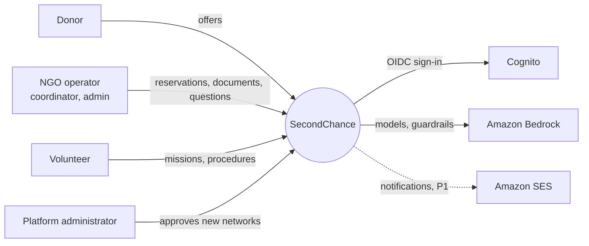
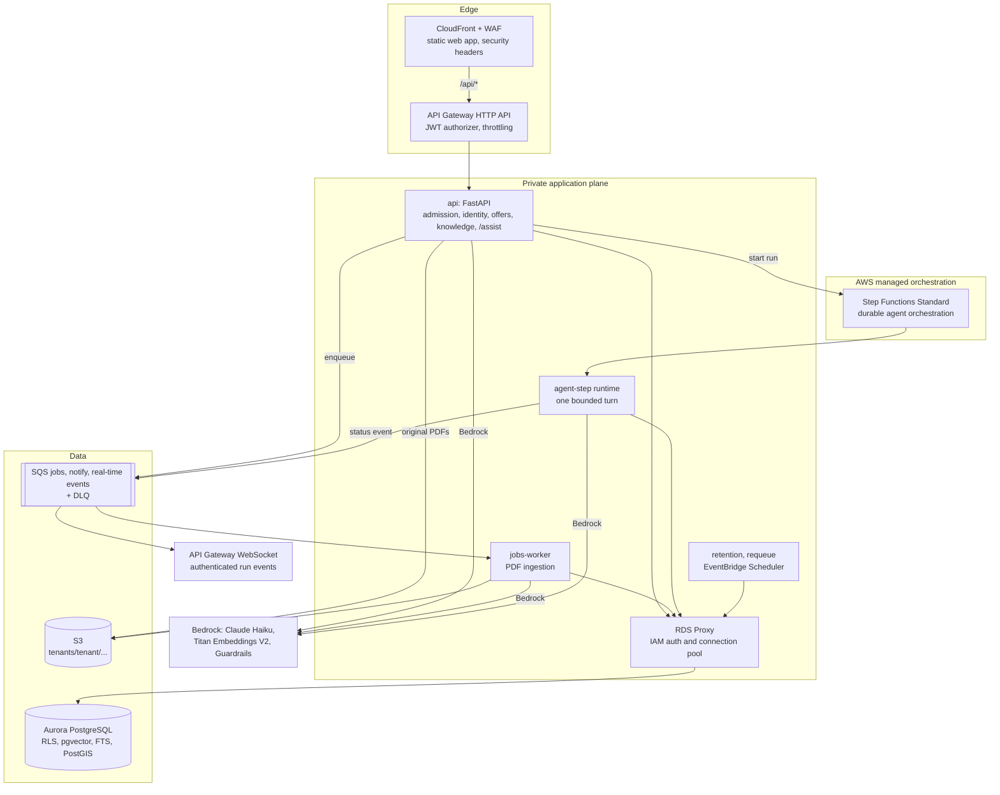
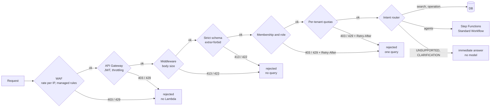
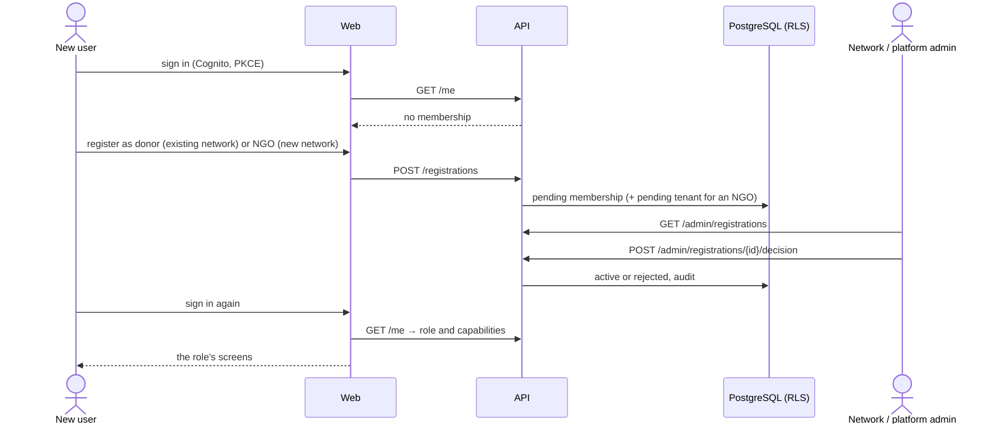
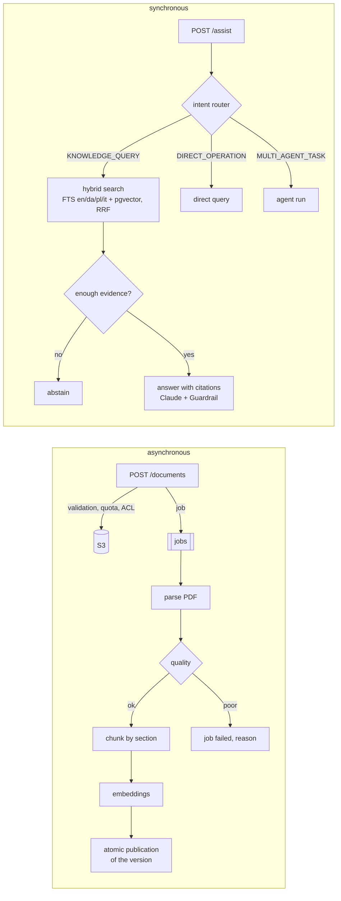
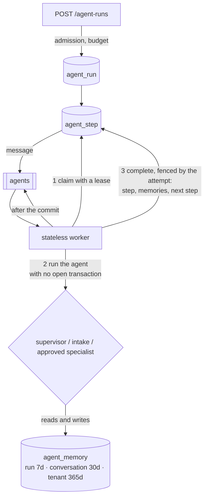

# SecondChance architecture

An overview of the system as it is in the code. Decisions and the alternatives they rejected are in the [ADRs](ADR.md); requirements in the [PRD](PRD.md); the map of AWS services and their local equivalents in [infra/README.md](../infra/README.md).

## Constraints that drive everything

1. **One maintainer, near-zero fixed cost:** serverless with scale to zero, no clusters, no NAT (ADR-001, ADR-006).
2. **Data about vulnerable people:** tenant isolation enforced by the database, personal data classified column by column, inference in the EU (ADR-002, ADR-003, ADR-014).
3. **AI proposes, people decide:** agents work inside deterministic workflows and never confirm an allocation (ADR-010).
4. **Useless work stops at the door:** every unsuitable request is rejected at the first stage that can recognise it (ADR-016).
5. **The same code locally and on AWS:** cloud services are adapters with an equivalent in Docker Compose (NFR-013).
6. **International from day one:** English first, with Danish, Polish and Italian in the interface, the documents and the intent router (ADR-019).

## Context

## Containers

Locally: nginx instead of CloudFront, no API Gateway (the API verifies the token itself), ElasticMQ for SQS, SeaweedFS for S3, PostgreSQL in a container, deterministic embeddings or Ollama instead of Bedrock.

## The path of a request: early rejection

Every stage rejects what it can recognise with the data it has, before handing over to the next, more expensive one. Details and HTTP codes in [ADR-016](ADR.md#adr-016--fail-fast-early-rejection-and-admission-control).

Checks continue after the door: PDFs are validated (signature, pages, encryption, active content) before anything is written to S3; workers drop malformed messages without retrying them; agent plans are validated before the first step. Every rejection increments `secondchance.admission.rejections` with stage and reason.

## Identity and roles

The token proves only **who** you are (`sub`). **What** you may do is decided by the `membership` table, read on every request (ADR-017). A revoked role stops working at once, without waiting for the token to expire.

Database triggers prevent approving oneself, changing a role through an update and activating a tenant without being a platform administrator.

| Role | Screens (from `web/src/nav.ts`) |
|---|---|
| `donor` | Assistant, Offers (their own), New offer, Knowledge |
| `coordinator` | Assistant, Offers (to reserve), Knowledge; agent runs through the API |
| `org_admin` | Assistant, Offers, Knowledge, Documents, Membership requests |
| `volunteer` | Knowledge, Missions (P1) |
| `center_staff` | Knowledge, My centre (P1) |
| `platform_admin` | Knowledge, Documents, Membership requests (new networks) |

## Languages

- The web app ships one typed dictionary per language in `web/src/locales`; `en.ts` defines the keys and the type check fails if Danish, Polish or Italian misses one. The picker is on every page, the choice is kept in the browser, English is the default.
- The API returns codes (statuses, categories, roles, assistant outcome kinds) and the interface translates them; dates, numbers, country and language names come from the browser `Intl` API.
- Documents and questions can be in English, Danish, Polish or Italian. PostgreSQL stems English, Danish and Italian; Polish uses the unstemmed `simple` configuration plus a prefix match on Polish chunks (`żywności` finds `żywność`), with dense retrieval for the rest. A question without a declared language is matched against all four.

## Knowledge and `/assist`

- **Knowledge spaces** belong to a tenant or are public; allowed roles live on the space row and RLS enforces them, so a chunk outside the ACL never even enters the ranking.
- A new version of a document replaces the previous one only when all its chunks are written; the same (document, sha256, pipeline version) is not processed twice.
- Without a configured model the answer is extractive; with Bedrock, the guardrail checks question and answer (prompt attacks, PII, grounding).

## Agent layer

- Any worker runs any step: state lives in the database, never in the process.
- A message delivered twice finds the step already done; a worker that dies lets its lease expire and the `requeue` job queues the step again.
- Every run has step and token budgets: when one runs out the run stops as `budget_exhausted` instead of spending more.
- Intake uses a safety-first hybrid cascade: deterministic unsupported rules and confident cheap paths first, schema-constrained Bedrock classification for compound/ambiguous work, and safe baseline fallback on refusal, invalid output or outage. Rizzo Flow can run as a recorded shadow challenger.
- The supervisor asks the configured model for a bounded JSON plan, validates every step against a versioned specialist catalog, and falls back to a deterministic route plan when the output is invalid or no model is configured.
- Specialists automatically inherit tenant-isolated memory, token accounting and read-only execution. Declared RAG capability is enforced both by the catalog resource contract and by the external MCP Gateway agent/role allow-list. Final synthesis has a bounded schema for summary, risks, evidence gaps and human-reviewed next action. See [the agent guide](agents.md).

## Data and isolation

- Every domain table has `tenant_id` and RLS policies; the API sets tenant and role with `SET LOCAL` at the start of every transaction. Composite foreign keys prevent references across tenants.
- Three database roles, none with `BYPASSRLS`: `secondchance_migrator` (owner, migrations), `secondchance_app` (API and workers), `secondchance_maintenance` (retention and requeue, through dedicated policies). On AWS they authenticate with IAM tokens, not passwords.
- Every column has a `pii:none|personal|sensitive` comment; a test fails if one is missing. Retention deletes expired data every night.

## Observability and experiments

- JSON logs with correlation ID and a filter that masks emails, phone numbers and IBANs; OpenTelemetry traces and metrics. Locally everything reaches Grafana (`--profile observability`); on AWS logs go to CloudWatch with alarms on errors, DLQs, queue age and budget.
- Experiments assign the variant with a deterministic hash of experiment and subject, record exposures and have a kill switch (ADR-013).

## How it scales

| Pressure | What happens |
|---|---|
| More API requests | Lambda scales out up to the reserved concurrency in the pilot (20), sized on Aurora connections; the demo reserves nothing and is bounded by the account quota |
| More documents or runs | queues absorb spikes; workers consume with at most 5 concurrent batches per queue; poisoned messages go to the DLQ after 5 attempts |
| More data | Aurora Serverless v2 grows in ACUs (up to 2 in the demo, 8 in the pilot); a reader in the second AZ in the pilot |
| A misbehaving client | WAF and throttling stop it before the code; per-tenant quotas stop it before the database |

## Known limits

- The Terraform is validated but not yet applied to an account: the checks to make are in [deployment.md](deployment.md#to-check-on-the-first-real-deployment).
- On AWS a PDF travels in the Lambda request body, so the limit is 4 MB; direct upload to S3 with a presigned URL is the next step (FR-015).
- Malware scanning of uploads (GuardDuty Malware Protection for S3) and a queue-backlog check at the door: planned, not implemented.
- The web app keeps tokens in `sessionStorage`; a BFF with `httpOnly` cookies would reduce XSS exposure.
- The checked-in multilingual golden set is a CI regression gate, not proof of domain readiness. Before a real association goes live it must be expanded with representative labelled requests and monitored for per-language/per-intent precision, recall, abstention and cost.
- Polish lexical search uses word prefixes instead of a stemmer; a Polish ispell dictionary is the upgrade if the golden set shows a recall gap.
