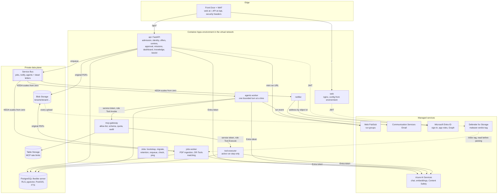

# Deploying to Azure

SecondChance runs on AWS or on Azure from the same code and the same images. You choose the cloud when you deploy; nothing else changes for the people who use it ([ADR-023](ADR.md#adr-023--multi-cloud-the-same-code-on-azure-with-adapters-container-apps-and-entra)). This guide is the Azure counterpart of [Deploying to AWS](deployment.md).

```bash
az login
export SECONDCHANCE_ALARM_EMAIL=you@example.org
scripts/connect.sh azure demo        # = scripts/azure/connect.sh demo
```

`connect` runs, in order: a **preflight against your real subscription** (providers, the models and database tier the region offers, free model quota, names that are still free, Entra rights), the **bootstrap** of the Terraform state and the deployment identity (once), the **deployment**, and the **verification**. Each step is also a script of its own: `deploy.sh`, `verify.sh`, `destroy.sh`, `grant-platform-admin.sh` in [`scripts/azure/`](../scripts/azure). `SECONDCHANCE_CLOUD=azure scripts/deploy.sh demo` reaches the same place.

## The architecture on Azure



Every arrow that crosses into a managed service is an Entra token of a **managed identity**. There is no password, key, connection string or secret anywhere in the Terraform configuration, the containers' environment or the CI.

## From logical component to service

| Component | AWS | Azure |
|---|---|---|
| Web app | S3 + CloudFront (OAC), `config.json` written by Terraform | nginx container (`web` image, `azure` target) behind Front Door; `/config.json`, the CSP and the origin lock rendered from its environment |
| Edge | CloudFront + WAF (managed rules, rate per IP) | Front Door + WAF policy: custom rate-limit rule (Standard), plus the default and bot rule sets (Premium); HSTS and friends as a rule set |
| Fail-fast token check | API Gateway JWT authorizer | in the API, before any database use (not an edge feature); the `X-Azure-FDID` check keeps the WAF unavoidable (Microsoft documents that a network security group cannot filter the inbound traffic of an external Container Apps environment) |
| Identity | Cognito user pool, Hosted UI, PKCE | Microsoft Entra ID (app registration, authorization code + PKCE), or Entra External ID for public self-sign-up; roles stay in `membership`; the subject is the object id (`oid`) |
| API | API Gateway → Lambda (Lambda Web Adapter) | Container App, scale on HTTP concurrency |
| Agent orchestration | Step Functions Standard → agent-step Lambda | the `agents` Service Bus queue → agents worker; leases, fencing and budgets live in PostgreSQL as before |
| Workers | Lambda on SQS (jobs, notify, realtime) | Container Apps scaled by KEDA on the Service Bus queues (zero to N) |
| Scheduled work | EventBridge Scheduler → Lambda | Container Apps jobs with a cron trigger (retention daily, requeue hourly in the demo, every two minutes in the pilot) |
| Notifications | SES + Cognito `ListUsers` | Azure Communication Services Email + Microsoft Graph (`User.Read.All`, by object id) |
| Data | RDS Proxy → Aurora Serverless v2 (IAM auth) | PostgreSQL flexible server in a delegated subnet, Entra authentication only, bounded connection pools instead of a proxy |
| Queues | SQS + DLQ after 5 receives | Service Bus queues, `max_delivery_count` 5, dead-letter sub-queue |
| Objects | KMS-encrypted S3, Block Public Access | Blob Storage, shared keys off, private endpoint, infrastructure encryption, versioning |
| LLM and embeddings | Bedrock: EU Claude Haiku profile, Titan Embeddings V2 | Azure OpenAI in the EU data zone (`DataZoneStandard`): chat deployment and `text-embedding-3-large` asked for 1024 dimensions |
| Guardrails | Bedrock Guardrails (`ApplyGuardrail`) | Azure AI Content Safety (Prompt Shields, harm categories, optional groundedness) + the deployments' default content filter |
| MCP tools | Lambda + IAM invoke + DynamoDB quota | Container Apps (internal ingress) + Entra app roles + Table Storage quota |
| Real-time | API Gateway WebSocket + DynamoDB + publisher Lambda | Web PubSub: the API mints a one-run URL, workers publish to the run's group |
| Detection | CloudTrail, GuardDuty, Malware Protection for S3 | blob logs in Log Analytics, Defender for Storage on-upload malware scanning |
| Observability | CloudWatch, SNS, Budgets, X-Ray/ADOT | Log Analytics, Application Insights (Entra-only), Azure Monitor alerts to an action group, resource-group budget |
| Network | VPC without NAT, interface endpoints | virtual network, private endpoints (storage, AI; Service Bus in Premium), PostgreSQL delegated subnet, optional NAT gateway |
| IaC state | S3 bucket with lock file | storage account, Entra auth only, blob lease locking |
| CI deployment identity | GitHub OIDC → IAM role with a permission boundary | GitHub OIDC → federated credential of an Entra app (Contributor + User Access Administrator on a dedicated subscription) |

## What the deployment creates

One resource group per environment (`rg-secondchance-demo` / `-pilot`), so destroying it leaves nothing behind. Names that must be globally unique carry a suffix derived from the subscription id: the same environment can be rebuilt under the same names, and two subscriptions never collide.

Managed identities, each with the narrowest role at the narrowest scope ([`identity.tf`](../infra/terraform/azure/modules/secondchance/identity.tf)):

| Identity | Holds | Attached to |
|---|---|---|
| `acrpull` | AcrPull on the registry | every app and job (image pulls only) |
| `app` | database role `secondchance_app`; send/receive on the three queues; read/write documents and read the malware tag (a custom role, no tag writes); OpenAI User and Cognitive Services User; Web PubSub Service Owner; telemetry publisher | api, jobs, agents, executor, check/ping/seed jobs |
| `agent` | the app role `Tool.Invoke` on the gateway | the agents worker only: the API cannot call tools |
| `gateway` | its rate-limit table; the app role `Tool.Execute` on the executor | the MCP gateway |
| `notifier` | receive on `notify`; Communication and Email Service Owner; Graph `User.Read.All` | the notifier |
| `maintenance` | database role `secondchance_maintenance`; send on the queues it re-feeds | retention, requeue |
| `migrator` | database role `secondchance_migrator` (owns the schema) | migrate |
| `dbadmin` | administrator of the server | bootstrap only |
| `scaler` | Service Bus Data Owner on the three queues (KEDA reads queue depth with it) | the queue consumers |

## Prerequisites

- An Azure subscription (a dedicated one is best, see below), an account that is **Owner** of it and may write to Microsoft Entra (Application Administrator is enough for the demo; granting the Graph application permissions needs Privileged Role Administrator or Global Administrator, once, in the bootstrap).
- `az` with the `containerapp` extension (the scripts install it), `terraform` ≥ 1.16, `docker`, `git`, `curl`, `python`. On Windows use Git Bash. The Docker-based Terraform fallback of the AWS scripts is not used here: Terraform must see your `az login`.
- Models: Azure OpenAI is subject to access and quota. The preflight lists what your region offers and stops if the chat or embedding model is missing or the quota is too low. Choose others with `SECONDCHANCE_CHAT_MODEL`, `SECONDCHANCE_CHAT_MODEL_VERSION`, `SECONDCHANCE_EMBEDDING_MODEL` and `SECONDCHANCE_EMBEDDING_MODEL_VERSION`; other regions with `SECONDCHANCE_AZURE_LOCATION`. Only EU/EFTA regions are accepted, and `Global*` model deployments are refused so that inference stays in the EU data zone ([ADR-002](ADR.md#adr-002--region-eu-central-1-with-the-eu-inference-profile)).

## 1. Once per subscription

`connect.sh` does this for you when the state storage account does not exist. By hand:

```bash
terraform -chdir=infra/terraform/azure/bootstrap init
terraform -chdir=infra/terraform/azure/bootstrap apply \
  -var subscription_id=<id> -var github_repository=<owner/name>   # the repository is optional
```

It creates the state storage account (Entra authentication only, versioned, locked against deletion) and the deployment identity `secondchance-deploy`, trusted by this repository's `production` environment through a federated credential. For GitHub Actions set the environment variables `AZURE_CLIENT_ID` (the `deploy_client_id` output), `AZURE_TENANT_ID`, `AZURE_SUBSCRIPTION_ID` and `SECONDCHANCE_ALARM_EMAIL`, then run the **Deploy** workflow and pick `azure`.

The deployment identity can create every resource and every role assignment of the environments, so it is as powerful as the subscription. Use a subscription dedicated to SecondChance and require a reviewer on the GitHub `production` environment: this is the Azure equivalent of the AWS deploy role's permission boundary, and it is weaker (see [the threat model](security/threat-model.md#azure-residual-risks)).

**Without Entra rights.** If the deploying identity may not write to Entra, create one app registration yourself (single-page application, redirect URIs `https://<front door host>/callback` and `/`, a v2.0 access-token version, an exposed scope `access_as_user`) and deploy with `SECONDCHANCE_CREATE_APP_REGISTRATIONS=false SECONDCHANCE_OIDC_CLIENT_ID=<its client id>`. Service-to-service tokens (gateway, executor) and the Graph address lookup are then not created: the private network is the boundary, and mission e-mails fall back to "recipient unknown" until `User.Read.All` is granted to the notifier identity.

**Public sign-up.** A workforce Entra tenant signs in members of that tenant and its guests. For donors and volunteers who register themselves, use an Entra External ID tenant: create it in the portal, create the app registration there, and pass `oidc_issuer` (`https://<tenant>.ciamlogin.com/<tenant-id>/v2.0`), `oidc_jwks_uri` and `oidc_client_id` to the pilot environment.

## 2. Deploy

```bash
scripts/azure/deploy.sh demo      # or pilot
```

1. creates the resource group and the container registry, and builds and pushes three images (`app`, `gateway`, `web`) tagged with the commit;
2. applies the infrastructure (the first time Front Door needs up to 20 minutes before its endpoint answers worldwide; the script waits);
3. runs the `bootstrap` job as the server's Entra administrator (creates the three database roles from the managed identities' object ids, the extensions, the ownership), then `migrate` (Alembic, the synthetic data in the demo), then in the demo `seed` (synthetic knowledge through Blob Storage and the embedding deployment);
4. smoke-tests `/api/health` through Front Door.

Then sign in once (Entra creates your account), and make yourself the first platform administrator:

```bash
scripts/azure/grant-platform-admin.sh demo you@example.org   # an e-mail or an Entra object id
```

## 3. Verify

```bash
scripts/azure/verify.sh demo
```

| Check | What it proves |
|---|---|
| `config.json` and `/api/me` through Front Door | the edge serves the app, rewrites `/api`, and the API refuses a call without a token (401) |
| a request straight to the origin | the origin lock holds (403, or refused by the network) |
| dead letters | none |
| the `ping` job and the `notify` queue | a message sent by the application identity is consumed by a worker that KEDA scaled up from zero: broker, role, scaler identity and worker all work |
| the `check` job | PostgreSQL through Entra authentication, the embedding and chat deployments, the Content Safety guardrail, the hybrid router and the OR-Tools solver, from inside the private network |
| the `tools` job (demo) | a `knowledge_search` through the gateway and the executor, with service tokens and RLS |
| Defender for Storage | reported as enabled, or a warning that uploads are unscanned |

## Verification

These are the checks that run in CI and on every deployment.

| Evidence | Covers |
|---|---|
| `terraform validate` on the module, both environments and the bootstrap, against the real provider schemas | every argument, block and reference exists with the right type |
| `terraform test` (10 scenarios on the module, one on each environment) with mocked providers whose resource ids are shaped like real Azure ids, so the **provider's own id and scope validators run** | the whole dependency graph applies in order; plan-time guards (EU regions, no `Global*` model deployments, replicas x pool within the database, bring-your-own app registration); nothing holds a secret; every data store is private; only the agent worker can reach the gateway; the pilot differs from the demo |
| Trivy on all the Terraform (HIGH and CRITICAL fail the build) and shellcheck on every script | misconfigurations, script defects |
| **75 checks of the scripts run end to end against stand-ins for `az`, `terraform`, `docker` and `curl`** (`scripts/azure/tests/run.sh`) | the order of the steps, the flags and variables each tool receives, every failure path (taken names, missing models, no quota, dead letters, an open origin, a worker that never scales, a failed job), the AWS/Azure switch, and that no script calls a command the stand-ins do not model. Every modelled command and flag was checked against `az ... --help` and the SDK models. Running it already found one real defect (Windows paths handed to native `git` and `terraform`) |
| 38 pytest tests of the Azure adapters in the API, 7 contract tests of the SDKs (the installed signatures and field names the adapters rely on) and 7 in the MCP gateway, next to the existing ones (341 in the API, all green against ElasticMQ, SeaweedFS and PostgreSQL) | the application code on both clouds; the AWS path is unchanged; an SDK release that renames something the adapters call fails the build |
| The role bootstrap SQL run against a real PostgreSQL 16 with PostGIS and pgvector | `CREATE DATABASE ... OWNER`, role settings, extensions: the statements are valid and the migrator ends up owning the database |
| The `azure` web image and the API image built and run with the Azure environment | nginx renders its configuration, origin lock and cache headers; the API boots with the Azure adapters selected, refuses a request that skipped the edge (403) and a request without a token (401) |
| Facts checked against Microsoft's documentation and repositories | the Defender tag key (`Malware Scanning scan result`, as in Microsoft's own scripts); the Content Safety and Prompt Shields request and response shapes; the built-in role ids; that managed-identity scale rules use `identity` and the queue/namespace metadata; the Front Door WAF SKU limits and rule-set versions; the NSG limitation above; the Defender prerequisite `Microsoft.EventGrid` |

What depends on the subscription, and where each is caught:

| Depends on the subscription | Caught by |
|---|---|
| model and SKU availability and quota in your region | `connect.sh` preflight, before Terraform |
| globally unique names already taken | `connect.sh` preflight |
| a second Free Web PubSub instance in the subscription | `connect.sh` preflight (`SECONDCHANCE_WEB_PUBSUB_SKU=Standard_S1`) |
| your identity's Entra and subscription rights | `connect.sh` preflight and the bootstrap |
| resource providers not registered | `connect.sh` registers them |
| role propagation delays and the 24-hour token cache of the managed-identity service | the apps start only after every role and app-role assignment has been made, plus a 60-second wait; the verification retries |
| KEDA reading queue depth with the scaler identity | the `ping` check of `verify.sh` |
| WAF managed rules blocking a legitimate PDF upload (Premium) | read `FrontDoorWebApplicationFirewallLog`; add an override for that rule |
| Front Door propagation | the scripts wait up to 25 minutes |
| Azure-side rules no schema describes (a name Azure refuses, a preview feature not enabled in your tenant) | `terraform apply` stops at the first refusal; fix and re-run: it is idempotent |

## What is not the same as on AWS

These are deliberate and documented, not oversights.

1. **Models differ**, so quality differs. The 1024-dimension embeddings come from another model: vectors are not interchangeable between clouds, and each cloud has its own database. The router's golden set (`api/evals/router_golden.v1.json`) and the RAG evaluation must be re-run on the Azure model before a real association relies on it ([architecture, known limits](architecture.md#known-limits)).
2. **The guardrail is a different product.** Prompt attacks and harm categories are checked on the question and the answer. PII anonymisation is not applied, and the grounding check is opt-in (`content_safety_groundedness`, a preview API in a few regions). The answer is still extractive from cited sources and abstains without evidence.
3. **The JWT is checked by the API, not at the edge.** Unauthenticated requests are refused with 401 before any database use, but they do reach a container (which may have to wake up). The WAF rate limit runs first.
4. **No scale-to-zero database.** The flexible server is always on (Burstable in the demo). That is the main fixed cost of the demo.
5. **Queue age is not a metric.** Service Bus has no "oldest message" metric: a standing backlog alarm stands in. Locks last at most 5 minutes and are renewed while a handler runs, where SQS visibility was 30 minutes.
6. **Platform-managed encryption keys** (AES-256, plus infrastructure encryption on storage). Customer-managed keys are the next step; they add a Key Vault, purge protection and an RBAC propagation dependency that this first version avoids.
7. **Subjects are Entra object ids**, so memberships are not portable between an AWS and an Azure deployment: they are separate installations.
8. **The application identity is shared** by the API and the workers because one database role maps to one Entra principal. The one separation that mattered for the tools path (the API cannot invoke the gateway) is kept with the `agent` identity.
9. **Cold starts.** With scale to zero the first request after idle time waits for a container (the pilot keeps the API and the gateway at one replica).

## Costs

Estimates in euros per month, region Germany West Central, at the time of writing; check the Azure pricing calculator before every deployment. Azure has fixed prices that AWS's serverless demo did not.

| Item | Demo | Pilot |
|---|---|---|
| PostgreSQL flexible server | Burstable B1ms ≈ 13 + storage | General Purpose D2ds v5, zone-redundant HA ≈ 250 + storage + backup |
| Front Door | Standard ≈ 35 | Standard ≈ 35 (Premium ≈ 300 adds the managed WAF rule sets) |
| Container Registry | Basic ≈ 5 | Standard ≈ 20 |
| Service Bus | Standard ≈ 10 | Standard ≈ 10 (Premium ≈ 650 adds private queues) |
| Defender for Storage | ≈ 10 + per GB scanned | same |
| NAT gateway | none | ≈ 35 |
| Container Apps, Log Analytics, Application Insights, models | by use; the free grants cover an idle demo | by use |
| **Budget alert** | 100 | 450 |

The budget alerts at 80% (actual) and 100% (forecast); it does not stop spending.

## Operating it

The runbooks in [docs/operations](operations/README.md) apply; their AWS signals map as follows.

| AWS signal | Azure |
|---|---|
| SQS DLQ not empty (RB-01) | `dead-letters` alert on `DeadletteredMessages`; inspect the `<queue>/$deadletterqueue` in the portal's Service Bus Explorer |
| queue age | `queue-backlog` alert on `ActiveMessages` |
| API 5xx (RB-02) | `api-5xx` (Container Apps `Requests` with `statusCodeCategory=5xx`) and `edge-5xx` (Front Door `Percentage5XX`) |
| latency, throttling (RB-03) | the restart alerts per app; Front Door `TotalLatency` and Service Bus `ThrottledRequests` in the portal's metrics (no alert on them yet) |
| Aurora connections (RB-04) | `database-connections` against the ceiling the replica limits were sized for; `database-cpu`, `database-storage`, `database-down` |
| Bedrock throttling (RB-05) | HTTP 429 from Azure OpenAI in the application logs; raise the deployment capacity |
| GuardDuty / infected upload (RB-11) | Defender for Cloud alerts (turn on its e-mail notifications); a version failed with `malware_scan:threats_found` |
| application errors | `errors` log alert; `mcp-denied-spike` for the gateway |
| restore (RB-10) | PostgreSQL point-in-time restore to a new server; point `SECONDCHANCE_DATABASE_URL` and the principals job at it |
| roll back a release | redeploy the previous image tag: `scripts/azure/deploy.sh` with that commit checked out |

Logs are in the Log Analytics workspace (`ContainerAppConsoleLogs_CL`, one JSON line per event, already redacted); traces and metrics in Application Insights.

## Teardown

```bash
scripts/azure/destroy.sh demo
```

The pilot's database and document store carry `CanNotDelete` locks and its resource group refuses deletion while it holds resources: set `deletion_protection = false`, apply, then destroy.
