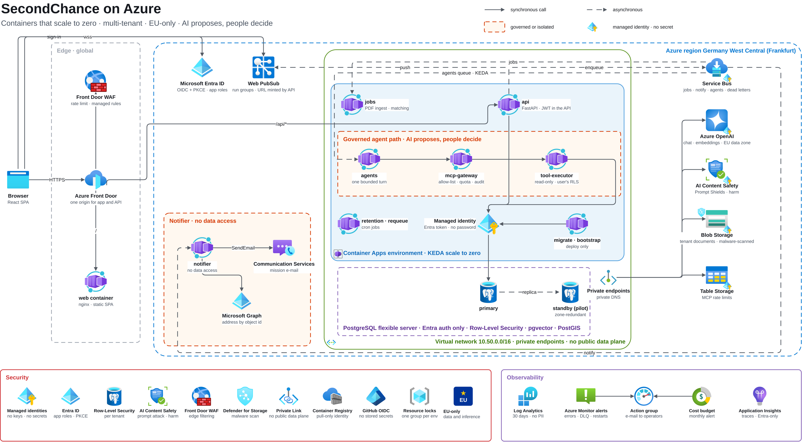

# SecondChance on Azure

Containers that scale to zero, multi-tenant, EU-only. AI agents propose, people decide.



The same picture as [the AWS one](linkedin-architecture.md), drawn with the official Azure icons: [PNG](images/linkedin-architecture-azure.png) (4706 px wide), [SVG](images/linkedin-architecture-azure.svg), and the editable [draw.io source](diagrams/linkedin-architecture-azure.drawio), generated by [`diagrams/linkedin-architecture-azure.gen.py`](diagrams/linkedin-architecture-azure.gen.py). Every service in it is created by `infra/terraform/azure/modules/secondchance`.

## How to read it

1. **Edge:** the browser reaches one Front Door endpoint. The WAF rate-limits first; `/` is the web container, `/api/*` the API. Containers answer 403 to anything that skipped Front Door.
2. **Identity:** Microsoft Entra ID signs users in (authorization code + PKCE). The token says *who*; the database decides *what* (Row-Level Security per tenant).
3. **Private data plane:** the apps run in a Container Apps environment inside a virtual network. PostgreSQL has no public endpoint, and storage and models are reached through private endpoints.
4. **Agents under governance:** the `agents` queue feeds one bounded turn at a time. Every tool call passes the MCP gateway (allow-list, quota, audit) and runs read-only in the executor, each hop with an Entra app role. Agents propose, a person confirms.
5. **No secret anywhere:** every arrow into a managed service is a managed identity's Entra token, including the database password. The small badge on a service means local keys are switched off.
6. **Async and real time:** heavy work goes through Service Bus and KEDA scales the workers from zero; run progress reaches the browser through Web PubSub; mission e-mails leave from a notifier that has no data access.
7. **Detection:** Defender for Storage scans every upload and the jobs worker parses a PDF only after a clean verdict.
8. **AI in the EU:** Azure OpenAI in the EU data zone, with Content Safety on prompt attacks and harm.

## Post text

> SecondChance now runs on **Azure** as well as AWS: same code, same images, you pick the cloud when you deploy.
> Container Apps that scale to zero, Front Door with a WAF, PostgreSQL with Row-Level Security, Service Bus, Azure OpenAI in the EU data zone, Defender for Storage on every upload. No password, key or secret anywhere: every service takes only managed identities.
> Every deployment is checked end to end by `scripts/azure/verify.sh`. AI agents propose, people decide.
> #Azure #AWS #MultiCloud #Terraform #Nonprofit #FoodWaste

## Re-generate

```bash
python docs/diagrams/linkedin-architecture-azure.gen.py
```

then export with the commands in the header of that script (copy the `.drawio` outside OneDrive first: the draw.io container hangs on synced folders).
