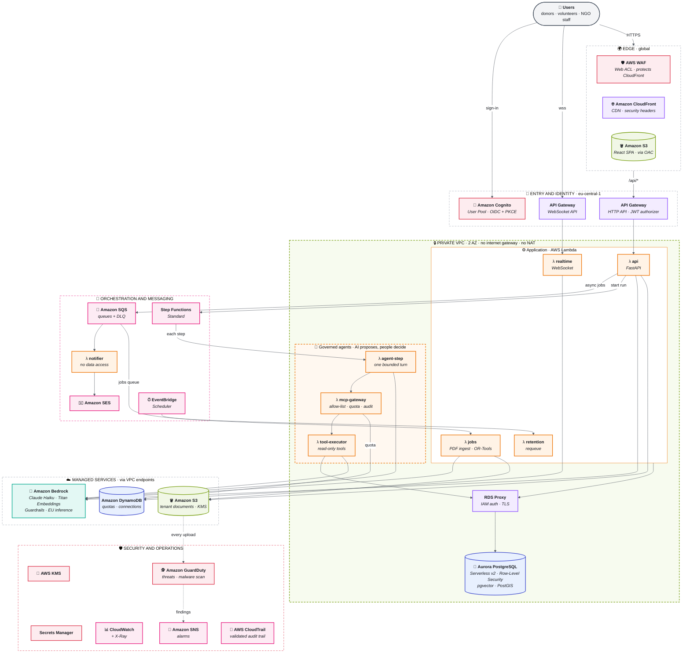

# SecondChance on AWS

Serverless, multi-tenant, EU-only. AI agents propose, people decide.

**Colour = AWS service category:** 🟧 compute · 🟪 networking · 🟩 storage · 🟦 database · 🟥 security and identity · 🩷 application integration · 🟢 machine learning.

## How to read it

1. **Edge:** the browser loads the React app from S3 through CloudFront, behind WAF. `/api/*` goes to API Gateway.
2. **Identity:** Cognito signs users in; API Gateway checks the JWT. The token says *who*, the database decides *what* (Row-Level Security per tenant).
3. **Private compute:** every Lambda that touches data runs in a VPC with no internet path. AWS services are reached through VPC endpoints.
4. **Agents under governance:** Step Functions runs the agent one bounded turn at a time. Every tool call passes an MCP gateway (allow-list, quota, audit) and runs read-only. Agents propose, a person confirms.
5. **Async and real-time:** heavy work (PDF ingestion, matching) goes through SQS. Results reach the browser over WebSocket; emails go out through SES, from Lambdas that have no database access.
6. **Detection:** CloudTrail records every AWS action and who touched which tenant document; GuardDuty watches the account and scans every upload, and the jobs worker parses a PDF only after a clean verdict.
7. **AI in the EU:** Bedrock with an EU inference profile, Guardrails on prompt attacks and personal data.

## Export as an image

Paste the `mermaid` block into https://mermaid.live, then **Actions → PNG** (or SVG). For a LinkedIn feed image, a 1200 px wide export reads well on mobile.
