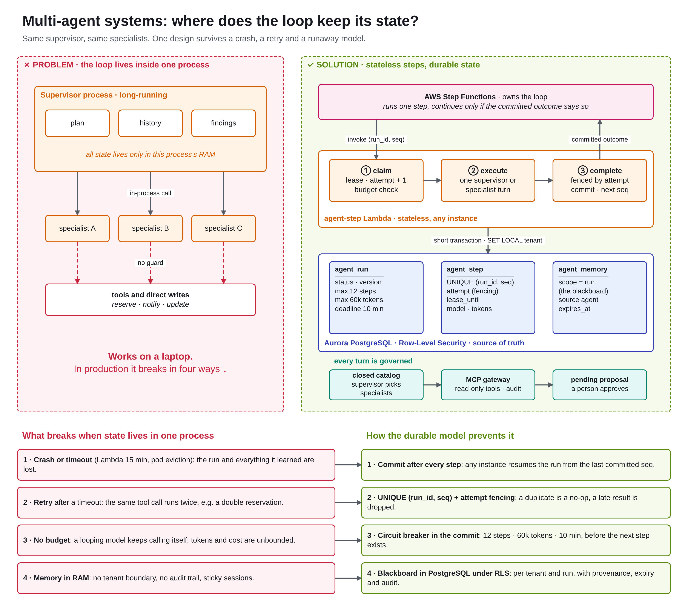

# LinkedIn draft · Multi-agent systems: where does the loop keep its state?

Second SecondChance post, after [SecondChance on AWS](linkedin-architecture.md). One design decision, as a problem and its fix.

Image to post: [`images/linkedin-multi-agent-state.png`](images/linkedin-multi-agent-state.png) (3200 × 2840). Editable source: [`diagrams/linkedin-multi-agent-state.drawio`](diagrams/linkedin-multi-agent-state.drawio), generated with the PNG layout by [`diagrams/linkedin-multi-agent-state.gen.py`](diagrams/linkedin-multi-agent-state.gen.py). It mirrors [`api/secondchance/agents/runtime.py`](../api/secondchance/agents/runtime.py) and migration `0002` (`agent_run`, `agent_step`, `agent_memory`).

---

## Post (English)

Your multi-agent system will crash mid-run. The real design question is: what survives?

Most multi-agent demos keep the supervisor loop inside one process. The plan, the conversation and every specialist's findings live in RAM while the supervisor calls specialists. On a laptop it works. In production it fails in four ways:

1️⃣ A timeout or restart (Lambda's 15 minutes, a pod eviction) kills the run and everything it learned.
2️⃣ A retry repeats a tool call that already happened: a reservation made twice.
3️⃣ Nothing stops a looping model from burning tokens.
4️⃣ Memory in RAM has no tenant boundary, no audit trail, and pins each run to one machine.

So the choice is not "which framework". It is: where does the loop keep its state?

In SecondChance my answer is: in no process at all.

How I modelled it:

→ A run is a state machine in PostgreSQL. agent_run holds status, version and the budgets: 12 steps, 60k tokens, 10 minutes. agent_step holds one row per turn: UNIQUE(run_id, seq), an attempt counter and a lease.

→ The agent is a function. Each step is claim (lease, attempt + 1, budget check) → execute one supervisor or specialist turn → complete in a short transaction fenced by that attempt. If the lease expired and another worker took over, the late result is dropped.

→ The loop lives outside the agent. AWS Step Functions invokes one bounded step and continues only if the committed outcome says "continue". The model's text never decides when to stop; the commit does.

→ The blackboard the agents share is a table under Row-Level Security: per tenant, per run, with provenance and expiry.

→ Star topology: the supervisor picks from a closed, versioned catalog of specialists and the server validates the plan. Every tool call crosses an MCP gateway, read-only. The only write is a pending proposal a person approves.

What it buys: any instance resumes any run from the last committed step, a duplicate message is a no-op, a runaway run stops in the same transaction that would have continued it, and every turn records model, prompt hash, tokens and latency.

The trade-off is real: more database round trips, and no hidden state in the framework (I skipped LangGraph checkpointers because they would duplicate state the database already owns). For a single-turn assistant it is overkill. For anything that runs for minutes, touches real data or serves more than one tenant, it is the first decision I would make.

Rule of thumb: the agent is a function, the run is a state machine, the database is the memory.

Code and ADRs: https://github.com/PierfrancescoLijoi/SecondChance

#AgenticAI #MultiAgent #LLMOps #SoftwareArchitecture #AWS #PostgreSQL

---

## Post (italiano)

Il tuo sistema multi-agente andrà in crash a metà di un run. La vera domanda di design è: cosa sopravvive?

Molte demo multi-agente tengono il loop del supervisor dentro un solo processo. Piano, conversazione e risultati degli specialist vivono in RAM mentre il supervisor li chiama. Sul laptop funziona. In produzione si rompe in quattro modi:

1️⃣ Un timeout o un restart (i 15 minuti di Lambda, un pod evicted) uccide il run e tutto quello che aveva capito.
2️⃣ Un retry ripete una tool call già eseguita: una prenotazione fatta due volte.
3️⃣ Nessuno ferma un modello che va in loop e brucia token.
4️⃣ La memoria in RAM non ha confini di tenant, non ha audit e lega ogni run a una macchina.

Quindi la scelta non è "quale framework". È: dove tiene lo stato il loop?

In SecondChance la mia risposta è: in nessun processo.

Come l'ho modellato:

→ Un run è una state machine in PostgreSQL. agent_run contiene stato, versione e budget: 12 step, 60k token, 10 minuti. agent_step ha una riga per turno: UNIQUE(run_id, seq), un contatore di tentativi e un lease.

→ L'agente è una funzione. Ogni step è claim (lease, attempt + 1, controllo budget) → execute di un solo turno di supervisor o specialist → complete in una transazione breve, protetta (fencing) da quel tentativo. Se il lease è scaduto e un altro worker ha preso lo step, il risultato in ritardo viene scartato.

→ Il loop vive fuori dall'agente. AWS Step Functions invoca uno step limitato e prosegue solo se l'esito committato dice "continue". Non è il testo del modello a decidere quando fermarsi: è il commit.

→ La blackboard condivisa dagli agenti è una tabella sotto Row-Level Security: per tenant, per run, con provenienza e scadenza.

→ Topologia a stella: il supervisor sceglie da un catalogo chiuso e versionato di specialist e il server valida il piano. Ogni tool call passa da un MCP gateway, in sola lettura. L'unica scrittura è una proposta pending che una persona approva.

Cosa si ottiene: qualsiasi istanza riprende qualsiasi run dall'ultimo step committato, un messaggio duplicato non fa nulla, un run fuori controllo si ferma nella stessa transazione che l'avrebbe fatto proseguire, e ogni turno registra modello, hash del prompt, token e latenza.

Il trade-off c'è: più round trip verso il database e nessuno stato nascosto nel framework (ho evitato i checkpointer di LangGraph perché duplicherebbero uno stato che il database possiede già). Per un assistente a turno singolo è eccessivo. Per tutto ciò che dura minuti, tocca dati reali o serve più di un tenant, è la prima decisione che prenderei.

Regola pratica: l'agente è una funzione, il run è una state machine, il database è la memoria.

Codice e ADR: https://github.com/PierfrancescoLijoi/SecondChance

#AgenticAI #MultiAgent #LLMOps #SoftwareArchitecture #AWS #PostgreSQL

---

## Image alt text

Two panels and a table. Left, in red: a long-running supervisor process holds plan, history and findings in RAM and calls three specialists, which write directly to tools with no guard. Right, in green: AWS Step Functions invokes a stateless agent-step Lambda once per turn (claim, execute, complete) and continues only on the committed outcome; the state lives in Aurora PostgreSQL tables agent_run, agent_step and agent_memory under Row-Level Security; every turn is governed by a closed specialist catalog, an MCP gateway with read-only tools and a pending proposal a person approves. Below, four failures of the in-process design, each mapped to its fix: commit after every step, UNIQUE (run_id, seq) with attempt fencing, a circuit breaker in the commit, and a blackboard in PostgreSQL under RLS.

## Changing the image

1. Edit `docs/diagrams/linkedin-multi-agent-state.gen.py` and run it from the repository root: it rewrites the `.drawio` and an HTML page with the same layout.
2. Export the PNG with a 2x screenshot of that HTML page (Chromium, viewport 1600 × 1420, `deviceScaleFactor: 2`), or open the `.drawio` in [app.diagrams.net](https://app.diagrams.net) and use **File → Export as → PNG**, zoom 200 %.
