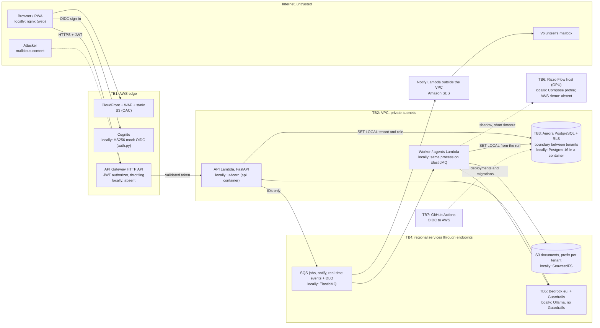

# SecondChance — Threat model

**Version:** 0.3 · **Status:** draft, aligned with the code and with ADR-001…019 · **Method:** STRIDE per trust boundary, OWASP Top 10 for LLM Applications 2025 · **Related documents:** [PRD](../PRD.md) · [ADR](../ADR.md)

This document separates what the code does today from what has only been decided. Status legend:

| Status | Meaning |
|---|---|
| active (test: `file`) | in the code and verified by a test in `api/tests/` |
| active, untested (`file`) | present in the code or configuration, no test verifies it |
| planned (Pn) | decided in the PRD or an ADR, not implemented yet |
| planned (Pn, TM proposal) | introduced by this document: to be accepted and carried into an ADR or the backlog |
| in Terraform, not applied | written and scanned, but never deployed to a real account |

`P3+` means the agent layer (ADR-010, ADR-011): PRD §9 gives it no phase of its own, and it cannot come before the P3 RAG.

## 1. Scope, assets and actors

**In scope.** The code (`api/`, `web/`, `db/`, `infra/`, `scripts/`, `docker-compose.yml`, `.github/workflows/`) and the architecture decided for P1-P4 (PRD §7, ADRs), including the agent layer, shared memory and Rizzo Flow in shadow mode.

**Out of scope.** The AWS account baseline (root, MFA, SCPs: assumed correct), physical and device security beyond the PWA, FL-03 (after the pilot), GDPR legal assessments and the DPIA (ADR-014).

**Assumptions.** Only synthetic data until the pilot (PRD §8.1). No beneficiary data in any phase (PRD §2.3). AWS keeps its side of the shared responsibility model.

### 1.1 Assets

| ID | Asset | Examples | Property | Impact if compromised |
|---|---|---|---|---|
| A1 | Domain data per tenant | organisations, centres, offers, missions, proposals | confidentiality, integrity | leaks between NGOs (NFR-003), altered allocations, lost food |
| A2 | Audit | `audit_event`, `agent_step` metadata | integrity, non-repudiation | loss of accountability (FR-004, OBJ-03) |
| A3 | Agent memory | `agent_memory` (`run`, `conversation`, `tenant` scopes) and embeddings | confidentiality, integrity | leaks; poisoned future decisions |
| A4 | Credentials and secrets | local JWT secret, Cognito user pool, IAM roles, local database passwords, GitHub → AWS OIDC trust | confidentiality | impersonation of any tenant, account access |
| A5 | Models and prompts | versioned templates, Guardrails configuration, Rizzo Flow weights, golden sets | integrity (public by choice) | AI behaviour altered without a trace |
| A6 | Availability and budget | API, queues, Aurora, Bedrock quotas, AWS spend | availability | pickups missed before expiry, costs |
| A7 | Personal data of operators and volunteers | IdP `sub`, emails in Cognito and SES | confidentiality | GDPR breach (arts. 33-34) |
| A8 | Objects | documents, attachments, solver artefacts in S3 | confidentiality, integrity | leaks; poisoned RAG corpus |

### 1.2 Actors

| Actor | Trust | Typical capability | Main threat |
|---|---|---|---|
| NGO operator / coordinator | authenticated, in their own tenant | reads offers, reserves, approves proposals | mistakes, careless approval, abuse within the tenant |
| Volunteer | authenticated, least privilege | assigned missions, from a phone, email sign-in | lost device, compromised mailbox |
| Donor | authenticated, own offers | free text in offers | malicious content, access to other donors' offers |
| Organisation admin | authenticated, administers the tenant | members and configuration | escalation towards other tenants |
| Platform admin | privileged | migrator role, AWS account | insider: RLS bypass, audit rewriting |
| External attacker | none | stolen tokens, credential stuffing, floods | impersonation, DoS, denial of wallet |
| Malicious tenant | legitimate user of a tenant | the full API of their tenant | cross-tenant leaks, oracles, consumption of shared resources |
| Technical insider | maintainer or contributor | PRs, CI, configuration | malicious code or dependencies, exposed secrets |
| Malicious content | data, not a human actor | documents, requests, offers, memory, tool output | indirect prompt injection |
| Upstream supplier | third party | packages, images, models | supply chain |

## 2. Trust boundaries

| Boundary | What crosses it | Why it matters |
|---|---|---|
| TB1 Internet → edge | all traffic, anonymous included | first filter: WAF, JWT authorizer and throttling |
| TB2 API Gateway → Lambda | requests with an already validated token | from here identity is only the `sub`; tenant and role come from `membership` |
| TB3 inside the database | every query of the `secondchance_app` role | the boundary between tenants is RLS, not the code |
| TB4 VPC → managed services | messages, objects, model calls | IAM, endpoint policies, keys derived from the context |
| TB5 application ↔ model | untrusted text in, untrusted output out | prompt injection, leaks, agency |
| TB6 Rizzo Flow host | request text, in shadow mode only | experimental service without authentication or rate limiting |
| TB7 CI/CD and suppliers | code, dependencies, images, deployment credentials | supply chain |

## 3. STRIDE per boundary

### 3.1 TB1-TB2: identity and API

| STRIDE | Scenario | Mitigation | Status | Residual risk |
|---|---|---|---|---|
| S | Forged, expired, wrong-issuer or wrong-audience token, `alg: none`, non-UUID `tenant_id` | HS256 locally, RS256 with the Cognito JWKS on AWS, read by Terraform at deploy time (no network call per request); `exp`/`iss`/`aud`/`sub` required, fixed algorithm; tenant and role never come from the token (ADR-017) | active (tests: `test_api.py`, `test_auth_cognito.py`) | Low |
| S | The literal development secret in `docker-compose.yml` ends up on an exposed host: anyone can mint tokens | ports on 127.0.0.1; the HS256 mock refuses to start outside `SECONDCHANCE_ENV=local` | active, untested (`auth.py`, `docker-compose.yml`) | High if Compose is exposed with `SECONDCHANCE_ENV=local` |
| S | A user changes their own `tenant_id` through a writable Cognito attribute | the token carries only `sub`; tenant and role come from `membership` on every request; `X-Tenant-ID` only chooses among the user's active memberships | active (test: `test_api.py::test_token_claims_cannot_choose_tenant_or_role`) | Low |
| S | A volunteer's session stolen (email link, lost phone) | short tokens, PKCE, PWA cache cleared on sign-out, missions with minimal data | planned (P1, P4) | The volunteer's email remains the only factor |
| T | Tampered body, extra fields, negative version | Pydantic models with `extra="forbid"`, `CHECK` constraints, `version ≥ 1` | active (test: `test_api.py`, `test_reservation.py`) | Low |
| T | Arbitrary `X-Correlation-ID` written to the audit | format validation (ADR-012) | active (test: `test_observability.py::test_correlation_id_is_echoed_or_minted`): format `[A-Za-z0-9._-]{1,64}`, otherwise a new one is generated | Low |
| R | An operator denies a reservation | audit event in the same transaction, with `sub`, role and correlation ID | active (test: `test_reservation.py`, `test_audit.py`) | `denied`/`failed` outcomes (401, 403, 409) not recorded: planned (P1, FR-004) |
| I | Errors revealing the schema or the existence of other tenants' rows | database errors as a generic 500; the same 409 for "does not exist" and "belongs to another tenant" | active (test: `test_api.py::test_other_tenant_cannot_reserve`) | Public `/docs` and `/openapi.json`: accepted, the project is open source |
| I | PII or the `Authorization` header in logs | formatter with allowlist and PII redaction (ADR-012) | active (test: `test_observability.py::test_log_lines_are_json_redacted_and_correlated`, `test_exceptions_lose_their_stack_and_personal_data`) | Low |
| D | Flood or denial of wallet with a valid account | WAF with per-IP rate, API Gateway throttling, body limit, per-tenant quotas, per-run budgets, `statement_timeout` | body limit and quotas active (test: `test_accounts.py::test_oversized_body_is_refused_before_parsing`, `test_agent_run_quota_rejects_before_creating_work`); WAF and throttling in Terraform, not applied | AWS Budgets warns but does not stop spending |
| D | `GET /offers` without pagination | `statement_timeout` 10 s | active, untested (`db/bootstrap.sql`); pagination planned (P1, TM proposal) | Low at current volumes |
| E | A valid but unsuitable role (donor, volunteer) reserves an offer | `require_roles` on writing endpoints | active (test: `test_api.py::test_donor_cannot_reserve`, `test_only_coordinators_start_agent_runs`) | Low |
| E | A donor reads or changes another donor's offers in the same tenant | a donor sees and creates only their own organisation's offers, taken from the membership | active (test: `test_api.py::test_donor_creates_and_sees_only_its_own_offers`) | Medium: the separation between organisations is in code, not in RLS |
| E | Direct Lambda invocation bypassing API Gateway | resource policy only for API Gateway, no function URL; the app verifies the JWT again | in Terraform, not applied (`edge.tf`) | Low |

### 3.2 TB3: database

| STRIDE | Scenario | Mitigation | Status | Residual risk |
|---|---|---|---|---|
| S | Connection with stolen credentials | IAM database authentication (short-lived token), security group open only to the functions; locally passwords and port on loopback | locally active, untested; IAM authentication in `dbconn.py` and in Terraform, not applied | Low |
| T | Writing rows of another tenant | RLS `USING` + `WITH CHECK`, composite FKs | active (test: `test_tenant_isolation.py`) | See §5 |
| T | Double concurrent reservation | optimistic lock on `version` | active (test: `test_reservation.py`, `test_api.py`) | None known |
| T | Offer status set to an arbitrary value with a direct `UPDATE` (grant on all columns) | `CHECK` on statuses; transitions in code | partial; transitions enforced in the database planned (P1, TM proposal) | Medium |
| R | The application role rewrites the audit | only `SELECT` and `INSERT` on `audit_event` | active (test: `test_audit.py`) | None for `secondchance_app` |
| R | The migrator (owner, RLS not `FORCE`) changes or deletes the audit | migrator credentials only in the `migrate` service and the pipeline | active, untested (`docker-compose.yml`) | Insider. An append-only copy (S3 Object Lock or hash chain) before the pilot: planned (P4, TM proposal) |
| I | Data intercepted in transit or read from backups | TLS to Aurora, KMS on Aurora and snapshots | in Terraform, not applied | Today `sslmode=require` without CA verification: move to `verify-full` with the RDS bundle before the pilot. Locally clear text on loopback: accepted |
| D | A stuck transaction holding an offer's lock | `statement_timeout` 10 s, `lock_timeout` 5 s, `idle_in_transaction_session_timeout` 30 s on the role | active, untested (`db/bootstrap.sql`) | Whoever controls the SQL can raise them with `SET`: a DoS defence, not a boundary |
| D | Lambda functions exhausting PostgreSQL connections | RDS Proxy pools and caps connections; application IAM roles connect only to the proxy resource; short transaction and lock timeouts remain active | implemented in Terraform; live capacity still requires the AWS acceptance test | Low to Medium under an untested extreme concurrency spike |
| E | The application role gains privileges | `NOSUPERUSER NOCREATEROLE NOBYPASSRLS`, owns no table | active (test: `test_tenant_isolation.py::test_app_role_is_not_owner_and_cannot_bypass_rls`) | None known |

### 3.3 TB4: queues, objects, workers, notifications

| STRIDE | Scenario | Mitigation | Status | Residual risk |
|---|---|---|---|---|
| S | Forged workflow input or queue message impersonating a tenant | `StartExecution` and `SendMessage` are role-scoped; identifiers are resolved again under RLS, so an inconsistent tenant/run pair finds zero rows | RLS and fenced-step tests active; IAM declared in Terraform | A principal with the application role can request replay, but the unique step and execution names make it idempotent |
| S | Emails imitating notifications (phishing against volunteers) | SPF, DKIM and DMARC on the SES domain; links only to the app's domain | planned (P1, P4; DMARC TM proposal) | Medium: volunteers are the easiest target |
| T | Step Functions retry or local SQS redelivery repeats an action | uniqueness of `(run_id, seq)`, fencing attempt and idempotent execution naming | active (tests cover redelivery, fencing and dispatch naming) | Low |
| T | Malicious upload (PDF bomb, fake type, huge file) bound for ingestion | magic bytes, size and page limits, active-content check, parsing in the worker; malware scanning on S3 | validation active (test: `test_knowledge.py::test_bad_files_are_rejected_before_storage`, `test_too_many_pages_is_a_422`); malware scanning planned (before the pilot) | Vulnerabilities in upstream parsers |
| T | User content (names, notes) injected into email HTML | template escaping, minimal text, no beneficiary data (FR-026) | planned (P1) | Low |
| I | Another tenant's object through a manipulated key | key `tenants/{tenant_id}/{area}/{id}` from the context, never from an argument; ABAC with session tags; short presigned URLs; Block Public Access | keys from the context active (test: `test_queues_storage.py::test_objects_live_under_the_transaction_tenant`, `test_unsafe_keys_are_rejected`); ABAC planned (P4) | ABAC needs a role assumption per request: to be checked |
| I | Personal data in messages or DLQs | IDs-only messages, SSE, short retention | active (test: `test_queues_storage.py::test_sqs_round_trip_carries_ids_and_correlation`) | Low |
| D | A poison message looping | DLQ with `maxReceiveCount`, alarm on a non-empty DLQ | active (test: `test_knowledge.py::test_malformed_job_messages_are_dropped_not_retried`); DLQ and alarm in `local/elasticmq.conf` and in Terraform, not applied | Low |
| E | Workers with broader permissions than the API | one IAM role per function; workers use `secondchance_app` under RLS, never the migrator | workers with `secondchance_app` under RLS active; IAM roles per function in Terraform, not applied | Low |

### 3.4 TB5-TB6: model, agents, Rizzo Flow

LLM threats in detail are in §4. Here only the STRIDE view.

| STRIDE | Scenario | Mitigation | Status | Residual risk |
|---|---|---|---|---|
| S | Generated output mistaken for a human decision | `generated_by` with agent, model and prompt; a label in the interface, in the user's language (AI Act art. 50) | active for knowledge answers (test: `test_knowledge.py::test_answer_is_cited_and_labelled_as_generated`); agents P3+ | Low |
| S | Another process calls Rizzo Flow, which has no authentication | Compose: internal network, port not published, optional profile; pilot: private VPC, security group open only to the worker | planned (P6, flag off by default) | Any container on the same internal network can call it |
| T | Prompt injection changing a proposal's parameters | hash of the content approved by the operator; read-only tools | planned (P3+) | See §4 |
| T | Rizzo Flow weights or binary replaced | pinned commit and sha256, fingerprint in every comparison | planned (P6) | Low |
| R | Unknown prompt or model behind an output | template hash and model ID per step (ADR-008) | columns `agent_step.model_id` and `prompt_sha256` and `model_id` in answers active; LLM agents P3+ | Low |
| I | Another tenant's context in the prompt | retrieval and memory under RLS before the model | active (test: `test_memory.py::test_other_tenant_sees_no_memory`, `test_knowledge.py::test_other_network_never_sees_private_documents`) | See §5 |
| I | Request text leaving the Rizzo Flow host | no external calls, text not recorded (ADR-007) | planned (P6) | Where the text lives for the shadow job is undefined: messages carry IDs only |
| D | Looping agent or saturated Rizzo Flow (one request at a time) | per-run budget; shadow outside the path with a short timeout | budget active (test: `test_agents.py::test_step_budget_ends_the_run_as_budget_exhausted`); shadow without impact (test: `test_routing.py::test_shadow_failure_is_recorded_and_never_raised`) | No impact on users |
| E | A tool writes without approval | read-only tools; `create_proposal` always `pending` | planned (P3+) | See §4 |

## 4. LLM and agent threats (OWASP Top 10 for LLM Applications 2025)

Today the code has the RAG pipeline (retrieval under RLS, abstention, citations, guardrail calls on question and answer when Bedrock is configured) and the agent runtime with rule-based agents. The LLM supervisor and tools do not exist yet: the "Phase" column says where the remaining work sits.

| OWASP 2025 | How it shows up in SecondChance | Mitigations | Phase |
|---|---|---|---|
| LLM01 Prompt injection | Direct: the operator's question (FL-02), free text from donors and volunteers at intake. Indirect: ingested documents, offer descriptions, memory, tool output | untrusted content delimited as data (ADR-010); Guardrails *prompt attack*, which evaluate only content marked as input: documents, memory and requests go into `guardContent` blocks, otherwise indirect injection passes (TM proposal); loop stopped on the `stop_reason`, never on the text; authorisation always outside the model (NFR-018) | P3, P3+ |
| LLM02 Sensitive information disclosure | Chunks or memory of another tenant; PII in prompts, logs, memory | RLS before retrieval (FR-043); memory with RLS and scope; Guardrails PII *mask*; code redaction of emails, phones and IBANs before logs, memory and prompts (ADR-014); Bedrock invocation logging off (ADR-008); `eu.` profile (ADR-002); never beneficiary data | P3, P3+ |
| LLM03 Supply chain | Models, Strands SDK, document parsers, Rizzo Flow weights | Bedrock model IDs with an explicit version; Ollama models pinned by digest (TM proposal); Rizzo Flow by commit and sha256; verified licences (NFR-024); SBOM (§6) | P3, P6 |
| LLM04 Data and model poisoning | Poisoned document in the corpus; false facts in `tenant` memory; altered golden set; Rizzo Flow calibrated on operators' labels | ingestion only from authorised, versioned sources, upload reserved to organisation admins (FR-040); `tenant` memory only with an operator's confirmation (ADR-011); golden set versioned and reviewed in PRs; no fine-tuning | P3, P3+ |
| LLM05 Improper output handling | Model output rendered in the interface, used as a tool argument, cited as a source | no generated SQL or code executed; tool arguments validated by schema; proposals re-validated by the deterministic rules (`compliance`) and database constraints; rendering as text with escaping (React); citations accepted only if the chunk ID is among those retrieved; Rizzo Flow returns only a choice from a closed set | P3, P3+ |
| LLM06 Excessive agency | An agent creating missions, reserving offers or changing tenant | read-only tools; the only write is `create_proposal` in `pending`, bound to the content hash; the operator approves that hash; no tool accepts `tenant_id`, which comes from the run; star topology; no agent executes approved actions (FR-022, FR-034); A/B experiments excluded from allocation, solver and food rules (`CHECK`, ADR-013) | P3+ |
| LLM07 System prompt leakage | Templates are files in the public repository | prompt secrecy protects nothing: no secrets, roles or authorisation rules in prompts; a leak has no impact by construction | P3 |
| LLM08 Vector and embedding weaknesses | Cross-tenant vector retrieval; mixed embedding spaces; embedding inversion | chunks and memory under RLS; `embedding_model` per row, comparisons only between vectors of the same model (ADR-011); embeddings protected like text; deduplication (FR-041); negative ACL tests (FR-043). An approximate index + RLS may return fewer results: a recall problem, not a leak, and it leads to abstention | P3, P3+ |
| LLM09 Misinformation | A wrong answer on food safety or an invented explanation of the solver | deterministic food rules that cannot be bypassed (FR-017); Guardrails contextual grounding; citations; abstention below the threshold without calling the model (FR-045); Rizzo Flow excluded from the abstention gate; faithfulness ≥ 95% on the golden set, per language (NFR-019) | P3 |
| LLM10 Unbounded consumption | Agent loops, huge prompts, floods with a valid account, denial of wallet | per-run budget (12 steps, 60,000 tokens, 10 minutes) with a `budget_exhausted` outcome; per-tenant run quotas; API Gateway throttling; reserved concurrency; DLQs; per-agent cost metrics (ADR-012); daily token quota per tenant (TM proposal). AWS Budgets warns but does not stop (PRD §6) | P3+, P4 |

Controls specific to the agent layer, beyond the table:

- **Approval bound to the hash.** The server computes the hash over a canonical serialisation of *all* parameters. The interface shows everything the hash covers. At execution hash, `pending` status and `version` are checked again in the same transaction, so no change slips in between approval and execution (TM proposal, P3+).
- **Habitual approval.** An approval rate close to 100% without edits means human control is emptying out: it belongs among the guardrail metrics (OBJ-05, ADR-013).
- **Guardrails mandatory on AWS.** The Lambda IAM policy requires the `bedrock:GuardrailIdentifier` condition key: a call without a guardrail is denied (TM proposal, P4).
- **Self-hosted without Guardrails.** Locally Ollama has no prompt-attack filter, PII mask or grounding. ADR-014 limits local use to synthetic data, but a self-hosted NGO with real data stays exposed. An explicit rule is needed: AI features off in self-hosted deployments with real data until an open-source equivalent exists (TM proposal, P3).

## 5. Multi-tenancy: RLS bypass vectors

| Vector | How it is closed | Status |
|---|---|---|
| Superuser, owner or `BYPASSRLS` role | no login role has `BYPASSRLS`; `secondchance_app` owns no table; migrations run as `secondchance_migrator`; maintenance jobs go through dedicated policies for `secondchance_maintenance` (migration 0005) | active (test: `test_tenant_isolation.py::test_app_role_is_not_owner_and_cannot_bypass_rls`, `test_no_role_bypasses_row_level_security`) |
| Tenant surviving on a pooled connection | `set_config(..., true)`, i.e. `SET LOCAL`, vanishes on commit or rollback | active (test: `test_tenant_isolation.py::test_tenant_setting_does_not_survive_on_pooled_connection`) |
| Query without a tenant set | `current_tenant_id()` returns `NULL`, so no rows | active (test: `test_tenant_isolation.py::test_without_tenant_setting_nothing_is_visible`) |
| Query without `WHERE` or filtering on another tenant | policy `tenant_id = current_tenant_id()` | active (test: `test_tenant_isolation.py`, `test_api.py`) |
| `INSERT` or `UPDATE` moving rows to another tenant | `WITH CHECK` on the same expression | active (test: `test_tenant_isolation.py::test_insert_for_other_tenant_is_rejected`) |
| FK to a row of another tenant (integrity checks ignore RLS) | composite FKs `(tenant_id, id)` | active (test: `test_tenant_isolation.py::test_reference_to_other_tenant_organization_is_rejected`) |
| New tenant table without RLS | catalogue test: every table with `tenant_id` has RLS on and at least one policy | active (test: `test_tenant_isolation.py::test_every_table_with_tenant_id_has_rls`) |
| `SECURITY DEFINER` functions or views, which run as owner and so without RLS | none exist; `current_tenant_id()` is `SECURITY INVOKER`; the two owner-run views (`network_directory`, `network_registration_queue`) expose only public columns or filter on `app.role` | active (test: `test_tenant_isolation.py::test_no_security_definer_functions_or_permissive_policies`, `test_accounts.py::test_directory_exposes_only_public_columns`) |
| Temporary table shadowing a real one | `REVOKE TEMPORARY ... FROM PUBLIC` | active, untested (`db/bootstrap.sql`) |
| Objects created by the application role (functions in `public`, `search_path` hijack) | no `CREATE` on the database and the `public` schema (PG 15+ default, migrator as owner) | active, untested (`db/bootstrap.sql`) |
| `SET row_security = off` | with RLS on, the query fails instead of bypassing it (PostgreSQL behaviour) | active, untested |
| Long transactions holding locks | timeouts on the role (§3.2) | active, untested (`db/bootstrap.sql`) |
| Worker context taken from the message | tenant from the message, run read again under RLS; never `tenant_id` as a tool argument | active (test: `test_agents.py::test_message_with_another_tenant_cannot_reach_the_run`) |
| Retrieval, memory and objects | the same RLS on chunks and `agent_memory`; S3 prefix from the context and ABAC; extended cross-tenant suite (ADR-011) | RLS on chunks and memory and S3 prefix active (test: `test_knowledge.py`, `test_memory.py`, `test_queues_storage.py`); ABAC planned (P4) |
| Shared caches and logs (NFR-003) | no cache in the MVP; logs with `tenant_id` as an attribute, never contents | planned (P1, P4) |
| Sharing between organisations (FR-005) | an agreements table under RLS; the first intended cross-tenant path, to be reviewed (§8) | planned (Should) |
| Platform admin access to several tenants | proposal: a separate, time-limited break-glass role with audit, never the application role | partial: reads only the `network_directory` and `network_registration_queue` views, filtered on `app.role`; break-glass planned (P4, TM proposal) |

**Limits of the catalogue test.** It covers only the `public` schema, ordinary tables (`relkind = 'r'`, not partitioned ones) and columns named exactly `tenant_id`. A `USING (true)` policy for a broad role would be caught by the permissive-policy test, but not one restricted to a single role. To be extended to `TEMP`/`CREATE` privileges of the application role (TM proposal, P1).

**Known and accepted residuals.**

- **SQL injection as a tenant escape (medium).** `secondchance_app` can call `set_config('app.tenant_id', ...)`, so an SQL injection can switch tenant. Active mitigation: every query in `api/secondchance/` uses `text()` with bound parameters, checked in review. Second active mitigation: the ruff rule `S608` blocks string-built SQL in CI in application code (migrations and tests excluded, as they interpolate only constants).
- **Existence oracle from global primary keys (low).** An `INSERT` with a chosen `id` belonging to another tenant fails on uniqueness and reveals its existence. Low because IDs are random UUIDs and the API accepts no client IDs on creation; only the seed uses deterministic UUID v5, on synthetic data. Migration rule: every domain `UNIQUE` constraint includes `tenant_id`.
- **Catalogue metadata (low).** `pg_class.reltuples` and the `pg_stat_*` views show platform-wide aggregate volumes. `pg_stats` hides statistics of tables with RLS on. Accepted.
- **Owner outside RLS.** RLS is not `FORCE`: the migrator sees and changes everything. Accepted because its credentials live only in the `migrate` service and the pipeline; the insider risk is in §7.

## 6. Supply chain and CI

| Control | Status |
|---|---|
| GitHub Actions pinned by commit SHA, `permissions: contents: read` | active, untested (`.github/workflows/ci.yml`) |
| Python dependencies locked with hashes in `uv.lock`; `uv sync --frozen` in the image, `uv run --locked` in CI | active, untested (`api/Dockerfile`, `ci.yml`) |
| Web dependencies pinned to exact versions with `package-lock.json`; `npm ci` in CI | active, untested (`web/package.json`) |
| ruff pinned to 0.16.10 with explicit rules | active (`lint` job), with rule `S608` against string-built SQL |
| Images pinned to a version (e.g. `python:3.12.14-slim-trixie`, `postgres:16.14-trixie`, `nginx:1.30.5-alpine`); apt packages in `db/Dockerfile` not pinned | active; pinning by digest planned |
| API container as `nobody`; `.dockerignore` excludes `.venv`; `.env` in `.gitignore` | active, untested (`api/Dockerfile`) |
| Tests refuse a database whose name does not end in `_test` (protection against the destructive downgrade) | active (`api/tests/conftest.py`) |
| Literal local credentials in `docker-compose.yml` | accepted: loopback only, declared local only; to allowlist in the scanner |
| Secret scanning (push protection and a CI scanner) | planned (NFR-024; TM proposal: P1) |
| Automatic dependency updates | active (`.github/dependabot.yml`, waiting 14 days after a release) |
| SBOM, image scanning (ECR or Trivy), IaC scanning of the Terraform | Trivy on the Terraform active (`iac` job); SBOM and image scanning planned |
| Deployment with GitHub OIDC → AWS without access keys, trust limited to the repository and environment | in Terraform, not applied: trust limited to the repository's `production` environment, permission boundary (`bootstrap/main.tf`, `deploy.yml`) |
| Licence check of dependencies, models and datasets | planned (NFR-024; before the pilot) |
| Pinned model artefacts (Bedrock versions, Ollama digests, Rizzo Flow sha256) | planned (P3, P6) |

## 7. Main residual risks

In priority order, assessed for reaching the pilot (likelihood times impact, after the planned mitigations).

| # | Risk | Why it remains | Responsible phase |
|---|---|---|---|
| 1 | A wrong registration approved: a fake donor or network gets an active role | approval is human and the platform does not verify organisations' identity | P1 (organisation data checks), P5 |
| 2 | Separation between organisations of the same tenant enforced in code, not in RLS | a new endpoint that forgets the filter exposes other donors' offers in the same tenant | P1 |
| 3 | Indirect prompt injection steering proposals and answers within the tenant | no filter is complete; human approval, hashes and read-only tools limit it | P3, P3+ |
| 4 | SQL injection as a tenant escape through `set_config` | accepted by design; mitigated by parameterised queries and the `S608` lint in CI | — |
| 5 | Insider with migrator or AWS account credentials: RLS bypass and audit rewriting | RLS is not `FORCE`; the audit has no immutable copy | P4, before the pilot |
| 6 | A token stolen from the browser: the web app keeps tokens in `sessionStorage`, readable by an injected script | a strict CSP and no external scripts reduce XSS, they do not rule it out | after P4 (BFF with `httpOnly` cookies) |
| 7 | Denial of wallet and shared saturation (noisy neighbour) | per-tenant quotas and per-run budgets limit the damage; AWS Budgets warns but does not stop | P4 |
| 8 | A malicious PDF exploiting the parser | structural validation and parsing in the worker, but no malware scanning | before the pilot |
| 9 | Self-hosted deployment with real data and no Guardrails | Ollama offers no prompt-attack filter, PII mask or grounding | P3 |
| 10 | A volunteer's account compromised (email, phone) | passwordless email sign-in, personal devices | P1 |
| 11 | Habitual approval emptying human control | human factor, mitigable only with metrics and interface design | P3+, P5 |

## 8. Keeping it alive

This document is versioned with the code. Every PR that touches a boundary updates the relevant row and its status: from "planned" to "active (test: …)" only when the test exists and is green in CI.

**Mandatory review when:**

- a new external integration arrives (AWS service, IdP, LLM provider, SES, Amazon Location, partner NGO);
- an agent gets a new tool, and all the more a tool that writes;
- a new data category arrives (attachments, partner documents, contacts, anything close to beneficiaries or GDPR art. 9);
- a migration adds a tenant table, a view, a function or a grant;
- authentication changes (claims, IdP, token lifetime);
- an intended cross-tenant path (FR-005) or platform-admin access opens;
- model, region or inference profile change, Rizzo Flow is promoted, a new A/B surface opens;
- after an incident or a red-team exercise (NFR-018);
- **before the pilot**: a full review together with the DPIA (ADR-014), with risks 1-5 of §7 closed or accepted in writing.

**Otherwise:** a review at the end of every phase (P1-P6) and when OWASP publishes a new edition of the LLM Top 10.
